# Audit V1.9a: Remaining Atomic Rule Readiness & Implementation Roadmap

## 1. Executive Summary

- **Audit Milestone:** Audit V1.9a — Remaining Atomic Rule Readiness & Implementation Roadmap Review
- **Repository:** `truthrive/technical-seo-audit`
- **Branch:** `main`
- **Baseline Git HEAD:** `65bbbb01fa85bca1d2b1a0235d4ecf53b66735b1`
- **Correction Baseline:** `bb59e3b3e1f64bfefcfcc5b8634335a8a187a935`
- **NormalizationVersion:** Strictly `v1.9.0` (unchanged)
- **Current Executable Rules:** Exactly `19 / 47` (40.4% coverage; unchanged in V1.9a)
- **Remaining Rules Assessed:** Exactly `28 / 47` (59.6% remaining)
- **Sitemap Rule Group:** `6 / 6` implemented (`100%` complete as of V1.8g)
- **Entity / Structured Data Rule Group:** `1 / 1` implemented (`100%` complete as of V1.7b)
- **Design-Only Assessment:** This milestone is strictly an architectural readiness review and implementation roadmap. Zero executable evaluator code, zero rule registrations, zero crawler modifications, zero SQLite schema diffs, zero adapter normalization alterations, and zero policy changes are introduced.

### Primary Milestone Conclusions

1. **Exact 47-Rule Inventory Reconciliation:** The frozen manifest (`knowledge/07-v1-atomic-rule-manifest.md`) and the machine-readable rule registry (`internal/audit/rules_v1.json`) agree on all 47 atomic rules. Across the codebase, exactly 19 rules are registered with typed executable evaluators in `internal/audit/engine/engine.go`, and exactly 28 rules remain unimplemented.
2. **Immediate Implementation Readiness (Zero Rules Ready):** Exactly **0 / 28** remaining rules are classified as `READY_TO_IMPLEMENT`. Prior assumptions that `AR-CANON-005` was immediately implementable have been corrected: source-level tracing demonstrates that raw canonical declarations and parse-error diagnostics are not independently preserved, and aggregate normalization failure cannot substitute for proven syntax failure without an approved contract decision.
3. **Primary Blocker Distribution Across the 28 Remaining Rules:**
   - **`READY_TO_IMPLEMENT` (0 rules):** No remaining rule has all frozen inputs and verdict paths independently verified in existing normalized observations.
   - **`NEEDS_CONTRACT_DECISION` (2 rules):** `AR-CANON-005`, `AR-INDEX-003`. (Semantic decisions required on failure substitution and token vocabularies before implementation).
   - **`NEEDS_ADAPTER_WIRING` (3 rules):** `AR-CANON-010`, `AR-LINK-005`, `AR-INDEX-005`. (Raw data exists in SQLite / page JSON, but normalized observations or subject correlation links are not yet emitted by the Adapter).
   - **`NEEDS_POLICY_WIRING` (2 rules):** `AR-ACC-003`, `AR-ACC-002`. (Explicit policy models exist in `policy.go`, but require connecting policy lookup to evaluator execution paths alongside minor adapter observations).
   - **`MANUAL_REVIEW_DEPENDENT` (1 rule):** `AR-LINK-006`. (By frozen contract, requires manual review task generation and human reviewer decision input; no automated threshold exists).
   - **`BLOCKED` (1 rule):** `AR-ACC-007`. (Blocked by absence of sub-resource network request tracking during render and proof of material content change from blocked CSS/JS).
   - **`NEEDS_ACQUISITION` (19 rules):** `AR-ACC-001`, `AR-ACC-005`, `AR-ACC-006`, `AR-ACC-008`, `AR-INDEX-004`, `AR-INDEX-006`, `AR-CANON-001`, `AR-CANON-002`, `AR-CANON-011`, `AR-LINK-001`, `AR-RENDER-001` through `006`, `AR-AI-001`, `AR-AI-002`, `AR-AI-003`. (Diagnostic active probes, multi-agent robots AST evaluation, dual raw/rendered DOM artifact storage, and multi-profile comparative fetching are not supported by the standalone crawler).
4. **Recommended Next Implementation Target:** **Milestone V1.9b — Canonical Syntax Evidence Contract Review (Design-Only)**. Before coding an evaluator for `AR-CANON-005`, the project must formally resolve three binding contract questions (DEC-V1.9A-001, DEC-V1.9A-002, DEC-V1.9A-003) regarding canonical failure semantics, unreadable source distinction, and evidence provenance requirements.

---

## 2. Verified Baseline and Rule Count

### 2.1 Git Preflight Verification

- Working tree status: clean (`git status` reports nothing to commit, working tree clean).
- Baseline SHA: `65bbbb01fa85bca1d2b1a0235d4ecf53b66735b1`.
- Correction Baseline SHA: `bb59e3b3e1f64bfefcfcc5b8634335a8a187a935`.
- Active branch: `main`.

### 2.2 Authoritative Source Cross-Reference

This readiness review was synthesized by cross-referencing:
1. `knowledge/INDEX.md` — Document routing and precedence hierarchy.
2. `knowledge/00-product-principles.md` — Diagnostic integrity, zero false positives, explicit policy separation.
3. `knowledge/01-audit-framework.md` — Core lifecycle stages (Crawl, Discover, Render, Index, Consolidate).
4. `knowledge/02-audit-check-catalog.md` — Parent diagnostic check taxonomy (ACC, INDEX, CANON, LINK, DISC, RENDER, AI).
5. `knowledge/03-rule-engine-spec.md` — Hermetic engine execution, frozen snapshot immutability, PolicyIndex contract.
6. `knowledge/04-ai-search-geo.md` — AI policy models (OAI-SearchBot, GPTBot) and strict factual guardrails against speculative SEO.
7. `knowledge/05-mvp-scope.md` — V1 boundaries and deferred capabilities.
8. `knowledge/07-v1-atomic-rule-manifest.md` — Authoritative semantic definitions, allowed verdicts, preconditions, and evidence requirements.
9. `knowledge/08-system-architecture.md` — Architectural boundaries between crawler, SQLite, adapter, and engine.
10. `knowledge/09-data-model.md` — Domain entity schemas, observation types, policy vocabulary.
11. `knowledge/10-implementation-plan.md` — Phased sequencing and progression strategy.
12. `internal/audit/rules_v1.json` — Machine-readable rule registry defining the 47 frozen rules.
13. Source implementation in `internal/audit/engine/**`, `internal/audit/adapter/**`, and `internal/sitecrawl/**`.

### 2.3 Rule Count Reconciliation: 47 Total = 19 Implemented + 28 Remaining

The frozen atomic rule manifest establishes 47 rules. Verification against `internal/audit/engine/engine.go` confirms:

```
Total Frozen Atomic Rules:        47
Implemented Executable Evaluators: 19
Remaining Unimplemented Rules:     28
Discrepancy:                       0
```

#### Breakdown by Functional Category

| Category | Parent Checklist | Total Rules | Implemented Rules | Remaining Rules | Implemented Rule IDs | Remaining Rule IDs |
|---|---|---:|---:|---:|---|---|
| **Access & Transport** | `ACC-001` to `ACC-007` | 8 | 1 | 7 | `AR-ACC-004` | `AR-ACC-001`, `AR-ACC-002`, `AR-ACC-003`, `AR-ACC-005`, `AR-ACC-006`, `AR-ACC-007`, `AR-ACC-008` |
| **Indexability Directives** | `INDEX-001` to `INDEX-007` | 6 | 2 | 4 | `AR-INDEX-001`, `AR-INDEX-002` | `AR-INDEX-003`, `AR-INDEX-004`, `AR-INDEX-005`, `AR-INDEX-006` |
| **Canonicalization & Redirects** | `CANON-001` to `CANON-007` | 11 | 6 | 5 | `AR-CANON-003`, `AR-CANON-004`, `AR-CANON-006`, `AR-CANON-007`, `AR-CANON-008`, `AR-CANON-009` | `AR-CANON-001`, `AR-CANON-002`, `AR-CANON-005`, `AR-CANON-010`, `AR-CANON-011` |
| **Internal Links & Graph** | `LINK-001` to `LINK-004` | 6 | 3 | 3 | `AR-LINK-002`, `AR-LINK-003`, `AR-LINK-004` | `AR-LINK-001`, `AR-LINK-005`, `AR-LINK-006` |
| **Sitemaps & Discovery** | `DISC-001` to `DISC-006` | 6 | 6 | 0 | `AR-DISC-001`, `AR-DISC-002`, `AR-DISC-003`, `AR-DISC-004`, `AR-DISC-005`, `AR-DISC-006` | *(None — 100% implemented)* |
| **Structured Data & Entity** | `ENTITY-001` | 1 | 1 | 0 | `AR-ENTITY-001` | *(None — 100% implemented)* |
| **JavaScript Rendering** | `RENDER-001`, `RENDER-002` | 6 | 0 | 6 | *(None)* | `AR-RENDER-001`, `AR-RENDER-002`, `AR-RENDER-003`, `AR-RENDER-004`, `AR-RENDER-005`, `AR-RENDER-006` |
| **AI Search & Policy** | `AI-001`, `AI-002` | 3 | 0 | 3 | *(None)* | `AR-AI-001`, `AR-AI-002`, `AR-AI-003` |
| **Total** | | **47** | **19** | **28** | | |

---

## 3. Complete 47-Rule Inventory

The following table provides the full inventory of all 47 frozen atomic rules, identifying their lifecycle, automation level, required inputs, preconditions, allowed verdicts, default severity, implementation status, and registered evaluator.

| Rule ID | Name | Parent Check | Lifecycle | Auto Type | Preconditions | Allowed Verdicts | Def Sev | Status | Evaluator Function |
|---|---|---|---|---|---|---|---|---|---|
| `AR-ACC-001` | HTTPS endpoint reachable | `ACC-001` | Crawl | deterministic | HTTPS origin derived from project origin | PASS, FAIL, UNKNOWN | P0 | Remaining | *(Unimplemented — NEEDS_ACQUISITION)* |
| `AR-ACC-002` | Robots access matches explicit crawl intent | `ACC-003` | Crawl | assisted | robots.txt parsed; expected_crawlable=true | PASS, FAIL, UNKNOWN, NOT_APPLICABLE | P1 | Remaining | *(Unimplemented — NEEDS_POLICY_WIRING)* |
| `AR-ACC-003` | HTTP status matches explicit expected URL state | `ACC-007` | Crawl | deterministic | expected_url_state is live, redirect, or missing | PASS, FAIL, UNKNOWN, NOT_APPLICABLE | P1 | Remaining | *(Unimplemented — NEEDS_POLICY_WIRING)* |
| `AR-ACC-004` | Unexpected server-error response | `ACC-006` | Crawl | deterministic | HTTP response obtained | PASS, FAIL, UNKNOWN | P1 | **Implemented** | `evaluateACC004` (`acc004.go`) |
| `AR-ACC-005` | Googlebot robots access matches explicit policy | `ACC-002` | Crawl | assisted | Googlebot robots policy parseable | PASS, WARNING, FAIL, UNKNOWN | P1 | Remaining | *(Unimplemented — NEEDS_ACQUISITION)* |
| `AR-ACC-006` | Googlebot profile response anomaly | `ACC-002` | Crawl | assisted | normal and Googlebot-profile requests attempted | PASS, WARNING, UNKNOWN, NOT_APPLICABLE | P1 | Remaining | *(Unimplemented — NEEDS_ACQUISITION)* |
| `AR-ACC-007` | Blocked CSS/JS resource affects rendered output | `ACC-004` | Render | assisted | CSS/JS referenced by rendered page | PASS, WARNING, FAIL, UNKNOWN, NOT_APPLICABLE | P1 | Remaining | *(Unimplemented — BLOCKED)* |
| `AR-ACC-008` | Bot-profile access restriction observed | `ACC-005` | Crawl | assisted | normal and alternate bot-profile requests completed | PASS, WARNING, UNKNOWN, NOT_APPLICABLE | P1 | Remaining | *(Unimplemented — NEEDS_ACQUISITION)* |
| `AR-INDEX-001` | Effective noindex conflicts with explicit indexability intent | `INDEX-002` | Index | assisted | directive evaluation completed; expected_indexable explicitly supplied | PASS, FAIL, UNKNOWN, NOT_APPLICABLE | P1 | **Implemented** | `evaluateINDEX001` (`index001.go`) |
| `AR-INDEX-002` | Conflicting index directives | `INDEX-001` | Index | deterministic | robots directives present | PASS, FAIL, UNKNOWN, NOT_APPLICABLE | P1 | **Implemented** | `evaluateINDEX002` (`index002.go`) |
| `AR-INDEX-003` | Malformed or unsupported robots directive | `INDEX-001` | Index | deterministic | meta robots or X-Robots-Tag exists | PASS, WARNING, UNKNOWN, NOT_APPLICABLE | P1 | Remaining | *(Unimplemented — NEEDS_CONTRACT_DECISION)* |
| `AR-INDEX-004` | Known-missing probe resolves to 404/410 | `INDEX-004` | Index | deterministic | collision-resistant URL generated | PASS, FAIL, UNKNOWN | P1 | Remaining | *(Unimplemented — NEEDS_ACQUISITION)* |
| `AR-INDEX-005` | Snippet restriction conflicts with snippet policy | `INDEX-007` | Index | assisted | snippet directives extracted | PASS, WARNING, FAIL, MANUAL_REVIEW, UNKNOWN, NOT_APPLICABLE | P1 | Remaining | *(Unimplemented — NEEDS_ADAPTER_WIRING)* |
| `AR-INDEX-006` | 200 response matches known 404 template | `INDEX-003` | Index | assisted | target is 200; missing probe returned 404/410 with fingerprint | PASS, WARNING, UNKNOWN, NOT_APPLICABLE | P1 | Remaining | *(Unimplemented — NEEDS_ACQUISITION)* |
| `AR-CANON-001` | Origin variants normalize to preferred origin | `CANON-001` | Consolidate | deterministic | explicit preferred origin; variant returns HTTP response | PASS, WARNING, FAIL, UNKNOWN, NOT_APPLICABLE | P1 | Remaining | *(Unimplemented — NEEDS_ACQUISITION)* |
| `AR-CANON-002` | Trailing-slash pair is consistently normalized | `CANON-002` | Consolidate | deterministic | both variants evaluable | PASS, WARNING, FAIL, UNKNOWN, NOT_APPLICABLE | P1 | Remaining | *(Unimplemented — NEEDS_ACQUISITION)* |
| `AR-CANON-003` | Canonical declaration missing | `CANON-003` | Consolidate | assisted | final response is 2xx HTML | PASS, WARNING, UNKNOWN, NOT_APPLICABLE | P1 | **Implemented** | `evaluateCANON003` (`canon003.go`) |
| `AR-CANON-004` | Multiple canonical declarations | `CANON-003` | Consolidate | deterministic | at least one canonical declaration exists | PASS, WARNING, FAIL, UNKNOWN, NOT_APPLICABLE | P1 | **Implemented** | `evaluateCANON004` (`canon004.go`) |
| `AR-CANON-005` | Canonical URL is syntactically resolvable | `CANON-003` | Consolidate | deterministic | exactly one canonical declaration exists | PASS, FAIL, UNKNOWN, NOT_APPLICABLE | P1 | Remaining | *(Unimplemented — NEEDS_CONTRACT_DECISION)* |
| `AR-CANON-006` | Canonical target returns final 200 | `CANON-003` | Consolidate | deterministic | exactly one valid target; fetch attempted | PASS, FAIL, UNKNOWN, NOT_APPLICABLE | P1 | **Implemented** | `evaluateCANON006` (`canon006.go`) |
| `AR-CANON-007` | Canonical target is not noindex | `CANON-003` | Consolidate | deterministic | exactly one valid target; target returns 200 | PASS, FAIL, UNKNOWN, NOT_APPLICABLE | P1 | **Implemented** | `evaluateCANON007` (`canon007.go`) |
| `AR-CANON-008` | Redirect chain exceeds one hop | `CANON-007` | Consolidate | deterministic | initial response redirects | PASS, FAIL, UNKNOWN, NOT_APPLICABLE | P1 | **Implemented** | `evaluateCANON008` (`canon008.go`) |
| `AR-CANON-009` | Redirect loop detected | `CANON-007` | Consolidate | deterministic | at least one redirect occurs | PASS, FAIL, UNKNOWN, NOT_APPLICABLE | P1 | **Implemented** | `evaluateCANON009` (`canon009.go`) |
| `AR-CANON-010` | Redirect final target is available | `CANON-007` | Consolidate | deterministic | redirect exists and no loop detected | PASS, FAIL, UNKNOWN, NOT_APPLICABLE | P1 | Remaining | *(Unimplemented — NEEDS_ADAPTER_WIRING)* |
| `AR-CANON-011` | Pagination exposes crawlable next-page link | `CANON-006` | Discover | assisted | paginated sequence identified; not final page | PASS, WARNING, UNKNOWN, NOT_APPLICABLE | P1 | Remaining | *(Unimplemented — NEEDS_ACQUISITION)* |
| `AR-LINK-001` | Internal navigation target lacks crawlable href | `LINK-001` | Discover | assisted | internal navigation candidate has resolvable target | PASS, WARNING, UNKNOWN, NOT_APPLICABLE | P1 | Remaining | *(Unimplemented — NEEDS_ACQUISITION)* |
| `AR-LINK-002` | Internal link targets 3xx | `LINK-002` | Discover | deterministic | resolved target is internal and fetchable | PASS, FAIL, UNKNOWN, NOT_APPLICABLE | P1 | **Implemented** | `evaluateLINK002` (`link.go`) |
| `AR-LINK-003` | Internal link targets 4xx | `LINK-002` | Discover | deterministic | resolved target is internal and fetchable | PASS, FAIL, UNKNOWN, NOT_APPLICABLE | P1 | **Implemented** | `evaluateLINK003` (`link.go`) |
| `AR-LINK-004` | Internal link targets 5xx | `LINK-002` | Discover | deterministic | resolved target is internal and fetchable | PASS, FAIL, UNKNOWN, NOT_APPLICABLE | P1 | **Implemented** | `evaluateLINK004` (`link.go`) |
| `AR-LINK-005` | Orphan candidate relative to supplied discovery sources | `LINK-003` | Discover | assisted | URL in at least one supplied non-crawl source and not start URL | PASS, WARNING, UNKNOWN, NOT_APPLICABLE | P1 | Remaining | *(Unimplemented — NEEDS_ADAPTER_WIRING)* |
| `AR-LINK-006` | Priority-page crawl depth review | `LINK-004` | Discover | manual | priority_page=true explicitly supplied | PASS, FAIL, MANUAL_REVIEW, UNKNOWN, NOT_APPLICABLE | P1 | Remaining | *(Unimplemented — MANUAL_REVIEW_DEPENDENT)* |
| `AR-DISC-001` | Sitemap presence matches project policy | `DISC-001` | Discover | assisted | root/robots sitemap discovery sources evaluated | PASS, WARNING, MANUAL_REVIEW, UNKNOWN, NOT_APPLICABLE | P1 | **Implemented** | `evaluateDISC001` (`disc001.go`) |
| `AR-DISC-002` | Sitemap document returns 200 | `DISC-002` | Discover | deterministic | sitemap discovered via robots.txt, common path, or index | PASS, FAIL, UNKNOWN | P1 | **Implemented** | `evaluateDISC002` (`disc002.go`) |
| `AR-DISC-003` | Sitemap is parseable | `DISC-003` | Discover | deterministic | sitemap fetch completed with response body | PASS, FAIL, UNKNOWN | P1 | **Implemented** | `evaluateDISC003` (`disc003.go`) |
| `AR-DISC-004` | Sitemap-listed URL returns final 200 | `DISC-004` | Discover | deterministic | sitemap entry parsed with resolvable loc | PASS, FAIL, UNKNOWN | P1 | **Implemented** | `evaluateDISC004` (`disc004.go`) |
| `AR-DISC-005` | Sitemap-listed URL is not noindex | `DISC-005` | Discover | deterministic | sitemap entry loc resolved and target returns 200 | PASS, FAIL, UNKNOWN | P1 | **Implemented** | `evaluateDISC005` (`disc005.go`) |
| `AR-DISC-006` | Sitemap-listed URL canonicalizes to itself | `DISC-006` | Discover | deterministic | sitemap entry target returns 200 HTML and canonical declared | PASS, FAIL, UNKNOWN, NOT_APPLICABLE | P1 | **Implemented** | `evaluateDISC006` (`disc006.go`) |
| `AR-ENTITY-001` | Structured-data block parses successfully | `ENTITY-001` | Discover | deterministic | JSON-LD / Microdata block extracted | PASS, WARNING, UNKNOWN, NOT_APPLICABLE | P2 | **Implemented** | `evaluateENTITY001` (`entity001.go`) |
| `AR-RENDER-001` | Title changes after render | `RENDER-002` | Render | deterministic | raw and rendered observations available | PASS, WARNING, UNKNOWN, NOT_APPLICABLE | P1 | Remaining | *(Unimplemented — NEEDS_ACQUISITION)* |
| `AR-RENDER-002` | Canonical changes after render | `RENDER-002` | Render | deterministic | raw and rendered observations available | PASS, WARNING, UNKNOWN, NOT_APPLICABLE | P1 | Remaining | *(Unimplemented — NEEDS_ACQUISITION)* |
| `AR-RENDER-003` | Robots directives change after render | `RENDER-002` | Render | deterministic | raw and rendered observations available | PASS, WARNING, UNKNOWN, NOT_APPLICABLE | P1 | Remaining | *(Unimplemented — NEEDS_ACQUISITION)* |
| `AR-RENDER-004` | H1 set changes after render | `RENDER-001` | Render | deterministic | raw and rendered observations available | PASS, WARNING, UNKNOWN, NOT_APPLICABLE | P1 | Remaining | *(Unimplemented — NEEDS_ACQUISITION)* |
| `AR-RENDER-005` | Main-text presence changes after render | `RENDER-001` | Render | deterministic | raw and rendered observations available | PASS, WARNING, UNKNOWN, NOT_APPLICABLE | P1 | Remaining | *(Unimplemented — NEEDS_ACQUISITION)* |
| `AR-RENDER-006` | Crawlable internal-link set changes after render | `RENDER-001` | Render | deterministic | raw and rendered observations available | PASS, WARNING, UNKNOWN, NOT_APPLICABLE | P1 | Remaining | *(Unimplemented — NEEDS_ACQUISITION)* |
| `AR-AI-001` | OAI-SearchBot robots access matches project policy | `AI-001` | Crawl | assisted | OAI-SearchBot robots policy can be evaluated | PASS, WARNING, FAIL, UNKNOWN | P2 | Remaining | *(Unimplemented — NEEDS_ACQUISITION)* |
| `AR-AI-002` | OAI-SearchBot profile encounters access anomaly | `AI-001` | Crawl | assisted | default and OAI-profile requests attempted | PASS, WARNING, UNKNOWN, NOT_APPLICABLE | P2 | Remaining | *(Unimplemented — NEEDS_ACQUISITION)* |
| `AR-AI-003` | GPTBot configuration matches explicit training policy | `AI-002` | Crawl | assisted | GPTBot robots state can be evaluated | PASS, WARNING, MANUAL_REVIEW, UNKNOWN | P2 | Remaining | *(Unimplemented — NEEDS_ACQUISITION)* |

---

## 4. Remaining 28-Rule Evidence Readiness Matrix

Each of the 28 unimplemented rules has been evaluated through the end-to-end trace:
`Frozen rule contract → required inputs → SiteCrawl acquisition → SQLite → Adapter → EvidenceSnapshot → Engine`.

The 12-column matrix below details the exact readiness state for every remaining rule.

| Rule ID | Rule Name | Automation | Required Evidence | Available Evidence | Missing Evidence | Policy Dependency | Contract Dependency | Code References | Readiness | Recommended Phase | Rationale |
|---|---|---|---|---|---|---|---|---|---|---|---|
| `AR-ACC-001` | HTTPS endpoint reachable | deterministic | `site_https_url`, `fetch_attempted`, `tls_valid`, `fetch_error_type`, `fetch_status` | `url_identity`, `http_status`, `fetch_error_type` on crawled pages | Dedicated HTTPS origin probe; TLS certificate validity verification | None | None | `internal/audit/adapter/adapter.go:640` (`tls_valid: nil`); `sitecrawl_pages` | `NEEDS_ACQUISITION` | V2.0a (Active Probes) | Crawled pages record HTTP status, but origin-level HTTPS reachability probe with explicit TLS handshake verification does not exist. |
| `AR-ACC-002` | Robots access matches explicit crawl intent | assisted | `url`, `robots_allowed_default`, `matched_robots_rule`, `expected_crawlable` | `sitecrawl_pages.robots_state` (allowed/blocked/unknown) | Normalized `robots_allowed_default` and `matched_robots_rule` on `SubjectURL`; granular matched pattern AST | `expected_crawlable` (URL scope) | None | `internal/sitecrawl/robots.go:28`; `internal/audit/adapter/adapter.go:2075`; `policy.go:60` | `NEEDS_POLICY_WIRING` | V1.15a (Crawler Intent & Robots) | `sitecrawl_pages` stores crawler UA outcome (`robots_state`), but the adapter does not emit `robots_allowed_default`, and the matched line/rule pattern is not persisted in SQLite. Primary blocker is explicit policy assignment wiring. |
| `AR-ACC-003` | HTTP status matches explicit expected URL state | deterministic | `url`, `expected_url_state`, `fetch_status`, `final_status` | `url_identity`, `http_status` on `SubjectURL` | Correlation of destination `final_status` across redirects; policy index evaluation | `expected_url_state` (URL scope: `live`, `redirect`, `missing`) | None | `internal/audit/policy.go:59,169`; `internal/audit/adapter/adapter.go:673` | `NEEDS_POLICY_WIRING` | V1.13b (Expected URL State) | `expected_url_state` is fully modeled in `policy.go`. `http_status` is available. Primary blocker is connecting explicit URL policy to the evaluation path. |
| `AR-ACC-005` | Googlebot robots access matches explicit policy | assisted | `url`, `robots_allowed_googlebot`, `googlebot_access_policy`, `matched_robots_rule` | Generic robots directives (`robots_directive_tokens`, `googlebot_meta_robots_raw`) | Googlebot-specific robots.txt AST parse and URL evaluation; matched directive line | `googlebot_access_policy` (Site scope: `allow`, `block`) | None | `internal/sitecrawl/robots.go:42`; `internal/audit/policy.go:54` | `NEEDS_ACQUISITION` | V2.1a (Robots Multi-Agent) | SiteCrawl only evaluates robots.txt for its own crawling User-Agent. It does not parse or evaluate a Googlebot-specific robots group against crawled URLs. |
| `AR-ACC-006` | Googlebot profile response anomaly | assisted | `url`, `default_profile_status`, `googlebot_profile_status`, `default_challenge_detected`, `googlebot_challenge_detected` | Single-profile fetch observations only | Dual-profile comparative HTTP fetch (default vs Googlebot UA); challenge header detection | None | Comparative threshold definition | `internal/sitecrawl/fetch.go`; `internal/audit/model.go:30` (`ProfileComparisonID`) | `NEEDS_ACQUISITION` | V2.2a (Multi-Profile Transport) | Requires issuing a secondary HTTP request with Googlebot User-Agent for comparison. Single-profile crawling cannot detect UA-specific blocking or cloaking. |
| `AR-ACC-007` | Blocked CSS/JS resource affects rendered output | assisted | `page_url`, `resource_url`, `resource_type`, `resource_robots_allowed`, `render_dependency_observed`, `render_diff_evidence` | None | Sub-resource request network log during render; sub-resource robots check; render output diff proof | None | Materiality threshold for rendered visual/content loss | `internal/sitecrawl/render.go`; `internal/audit/model.go:281` (`RenderResourceObservation`) | `BLOCKED` | Deferred (Post-V2) | Standalone crawler does not capture sub-resource network events or verify sub-resource robots.txt. Proving material output change caused by blocked CSS/JS requires DOM dependency diffing. |
| `AR-ACC-008` | Bot-profile access restriction observed | assisted | `url`, `default_profile_status`, `bot_profile_status`, `default_challenge_detected`, `bot_challenge_detected`, `tested_user_agent` | `sitecrawl_pages.data.botBlocked` (Boolean flag) | Multi-profile structured comparative HTTP fetch observations; WAF challenge marker taxonomy | None | None | `internal/sitecrawl/types.go:415`; `internal/audit/adapter/adapter.go:640` | `NEEDS_ACQUISITION` | V2.2a (Multi-Profile Transport) | While `botBlocked` exists in `Page` JSON, it is an opportunistic fallback marker rather than a hermetic comparative multi-profile test across controlled user-agents. |
| `AR-INDEX-003` | Malformed or unsupported robots directive | deterministic | `url`, `robots_directive_tokens`, `robots_parse_errors` | `robots_directive_tokens`, `meta_robots_raw`, `x_robots_raw` on `SubjectURL` | Explicit `robots_parse_errors` or `unsupported_tokens` normalized observation | None | **DEC-V1.9A-004: Authoritative V1 supported directive token vocabulary registry** | `internal/audit/adapter/adapter.go:2146`; `internal/audit/rules_v1.json:344` | `NEEDS_CONTRACT_DECISION` | V1.10a (Directive Syntax Contract) | Raw tokens are emitted on `SubjectURL`. However, the repository lacks an approved frozen registry defining exact supported tokens vs malformed syntax. Primary blocker is contract decision on token taxonomy. |
| `AR-INDEX-004` | Known-missing probe resolves to 404/410 | deterministic | `missing_probe_url`, `probe_final_status`, `probe_final_url` | None | Active diagnostic probe generator for non-existent probe URL; terminal status recording | None | None | `internal/audit/model.go:296` (`ProbeObservation`); `internal/sitecrawl/crawler.go` | `NEEDS_ACQUISITION` | V2.0a (Active Probes) | Crawling only visits discovered links and sitemaps. A synthetic collision-resistant probe request (e.g. `/sitecrawl-probe-nonexistent-404-uuid`) must be executed to verify server 404 handling. |
| `AR-INDEX-005` | Snippet restriction conflicts with snippet policy | assisted | `url`, `nosnippet`, `max_snippet`, `data_nosnippet_count`, `snippet_policy` | Directives parsed (`directive_tokens`); meta robots raw | Normalized snippet token observations (`nosnippet`, `max_snippet`); HTML `data-nosnippet` count | `snippet_policy` (Site scope: `allow_unrestricted`, `restrict`) | None | `internal/audit/policy.go:53,146`; `internal/audit/adapter/adapter.go:1701` | `NEEDS_ADAPTER_WIRING` | V1.16a (Snippet Policy & Directives) | `snippet_policy` is modeled in `policy.go`. Directive tokens are split in adapter, but snippet-specific tokens (`nosnippet`, `max-snippet`) and HTML `data-nosnippet` elements are not normalized onto `SubjectURL`. |
| `AR-INDEX-006` | 200 response matches known 404 template | assisted | `url`, `fetch_status`, `content_fingerprint`, `known_404_content_fingerprint`, `known_404_probe_status` | `url_identity`, `http_status` on `SubjectURL` | Known-missing 404 probe execution; DOM structural/text content fingerprinting of 404 template | None | Fingerprint comparison threshold (exact hash vs DOM tree similarity) | `internal/audit/model.go:167` (`ContentFingerprint`); `internal/audit/model.go:296` | `NEEDS_ACQUISITION` | V2.0b (Soft 404 Detection) | Depends on `AR-INDEX-004` probe acquisition and normalized DOM content hashing/fingerprinting across 200 responses to detect soft-404s. |
| `AR-CANON-001` | Origin variants normalize to preferred origin | deterministic | `preferred_origin`, `origin_variant`, `variant_fetch_status`, `variant_final_url`, `redirect_hops` | None | Multi-origin active variant probes (http vs https, www vs non-www); redirect chain capture | `preferred_origin` (Site scope) | None | `internal/audit/policy.go:51,126`; `internal/audit/model.go:296` | `NEEDS_ACQUISITION` | V2.0a (Active Probes) | SiteCrawl only crawls URLs from seed frontier. Probing all 4 origin variants (`http://`, `https://`, `http://www.`, `https://www.`) requires dedicated origin probe runner. Secondary policy dependency. |
| `AR-CANON-002` | Trailing-slash pair is consistently normalized | deterministic | `slash_url`, `non_slash_url`, both response states, redirect paths, `normalized_content_hash` | Crawled URLs have status and content | Paired slash/non-slash request execution; normalized DOM content hash comparison | None | Pair selection heuristic (seed URL vs sampled internal URLs) | `internal/sitecrawl/crawler.go`; `internal/audit/model.go:296` | `NEEDS_ACQUISITION` | V2.0a (Active Probes) | Crawler canonicalizes URLs before fetch to avoid infinite loops, preventing dual fetch of slash/non-slash pairs without dedicated diagnostic probe runner. |
| `AR-CANON-005` | Canonical URL is syntactically resolvable | deterministic | `url`, `canonical_raw`, `canonical_resolved_url`, `canonical_parse_error` | `url_identity`, `canonical_count`, `canonical_resolved` (absolutized string), `canonical_normalization_complete`, `canonical_normalized_target` | Independent pre-absolutized `canonical_raw`; explicit `canonical_parse_error`; unreadable source distinction | None | **DEC-V1.9A-001 (Failure semantics), DEC-V1.9A-002 (Source completeness), DEC-V1.9A-003 (Provenance requirements)** | `internal/sitecrawl/extract.go:568,595`; `internal/audit/adapter/adapter.go:1113,1175,1596`; `knowledge/07-v1-atomic-rule-manifest.md:346` | `NEEDS_CONTRACT_DECISION` | V1.9b (Canonical Syntax Contract Review) | SiteCrawl overwrites raw declaration with absolutized URL and suppresses parse errors. The adapter sets `RawValues: nil` and `ParseErrors: nil`. `canonical_normalization_complete=false` represents aggregate normalization failure rather than proven syntax failure. Requires binding contract decision before evaluator implementation. |
| `AR-CANON-010` | Redirect final target is available | deterministic | `url`, `redirect_hops`, `final_status`, `redirect_loop_detected` | `redirect_initial_observed`, `redirect_hop_count`, `redirect_hop`, `redirect_traversal_complete`, `redirect_loop_detected`, `redirect_final_url` | Terminal `final_status` observation on `SubjectURL`; target subject correlation for terminal hop | None | Contract for external redirect target terminal status | `internal/sitecrawl/fetch.go:190`; `internal/audit/adapter/adapter.go:886`; `internal/audit/engine/redirect_helpers.go` | `NEEDS_ADAPTER_WIRING` | V1.11b (Redirect Target Availability) | Hops and final URL are normalized. But `fetch.go` terminal status (`out.FinalStatus`) was not written to `sitecrawl_pages`. If target was crawled internally, adapter can correlate; if offsite, status is missing. Primary blocker: adapter correlation. |
| `AR-CANON-011` | Pagination exposes crawlable next-page link | assisted | `url`, `pagination_detected`, `has_next_page`, `next_page_url`, `next_page_element_tag`, `next_page_href` | `sitecrawl_pages.data.relNext` (raw string) | Pagination sequence identification; crawlable `<a href>` extraction; infinite scroll detection | None | Definition of pagination candidate elements beyond `<link rel=next>` | `internal/sitecrawl/types.go:435`; `internal/sitecrawl/extract.go` | `NEEDS_ACQUISITION` | V2.3a (Pagination Sequences) | Manifest guardrail explicitly forbids relying solely on deprecated `rel=next/prev` tags. HTML sequence identification and markup link extraction are required. |
| `AR-LINK-001` | Internal navigation target lacks crawlable href | assisted | `source_url`, `navigation_candidate`, `resolved_internal_target`, `element_tag`, `href` | Valid hyperlinks extracted in `sitecrawl_links` | Extraction of non-anchor navigation candidates (`<button>`, `<div onclick>`, script navigation) | None | Navigation candidate element selector contract | `internal/sitecrawl/extract.go`; `internal/audit/model.go:212` (`NavigationCandidate`) | `NEEDS_ACQUISITION` | V2.4a (JavaScript Navigation Discovery) | Crawler currently only extracts `<a href>` and `<link href>` tags. Elements functioning as internal navigation without valid `href` are not captured in SQLite. |
| `AR-LINK-005` | Orphan candidate relative to supplied discovery sources | assisted | `url`, `discovery_sources`, `crawl_inlink_count`, `is_start_url`, `crawl_complete` | `sitecrawl_pages.inlinks`; `sitecrawl_sitemap_entries.listed_url_raw` | Normalized `crawl_inlink_count` and `discovery_sources` on `SubjectURL` | None | None | `internal/sitecrawl/runs.go:88` (`inlinks`); `internal/audit/adapter/adapter.go:640` | `NEEDS_ADAPTER_WIRING` | V1.12b (Orphan URL Discovery) | Raw inlinks are counted in SQLite (`sitecrawl_pages.inlinks`) and sitemap entries exist in `sitecrawl_sitemap_entries`. The adapter does not emit `crawl_inlink_count` or supplemental source flags on `SubjectURL`. |
| `AR-LINK-006` | Priority-page crawl depth review | manual | `url`, `crawl_depth`, `priority_page` | `url_identity`, `crawl_depth` on `SubjectURL` | Manual review task generation; reviewer decision workflow | `priority_page` (URL scope) | Contract for manual review task records and human verdict entry | `internal/audit/adapter/adapter.go:706`; `internal/audit/policy.go:62,191`; `internal/audit/model.go:35` | `MANUAL_REVIEW_DEPENDENT` | V1.14b (Priority Crawl Depth Review) | `crawl_depth` is already normalized. `priority_page` is modeled in `policy.go`. By frozen manifest contract, this rule has no automated pass/fail threshold and produces `MANUAL_REVIEW`. Secondary policy dependency. |
| `AR-RENDER-001` | Title changes after render | deterministic | `url`, `title_raw`, `title_rendered` | Post-render `title` (when render enabled) or raw `title` (when disabled) | Concurrent dual-capture: pre-render raw server HTML title AND post-render headless browser title | None | None | `internal/sitecrawl/page.go:54`; `internal/audit/adapter/adapter.go:906` (`GapRenderedRawSourceUnavailable`) | `NEEDS_ACQUISITION` | V2.5a (Render Comparison Engine) | When rendering is active, SiteCrawl replaces raw server HTML with rendered DOM. Raw HTML title is discarded, preventing raw-vs-rendered comparison. |
| `AR-RENDER-002` | Canonical changes after render | deterministic | `url`, `canonical_raw`, `canonical_rendered` | Post-render or pre-render canonical declarations | Concurrent dual-capture of raw server canonical set AND rendered DOM canonical set | None | None | `internal/sitecrawl/render.go`; `internal/audit/adapter/adapter.go:906` | `NEEDS_ACQUISITION` | V2.5a (Render Comparison Engine) | Standalone crawler does not store raw server HTML alongside rendered DOM. Both sets must be persisted to detect client-side canonical modification. |
| `AR-RENDER-003` | Robots directives change after render | deterministic | `url`, `meta_robots_raw`, `meta_robots_rendered` | Post-render or pre-render meta robots directives; HTTP X-Robots-Tag | Concurrent dual-capture of raw server meta robots AND rendered DOM meta robots | None | None | `internal/sitecrawl/render.go`; `internal/audit/adapter/adapter.go:906` | `NEEDS_ACQUISITION` | V2.5a (Render Comparison Engine) | Dual capture required. Directives injected or altered by client-side JavaScript cannot be diffed without retaining pre-render server HTML. |
| `AR-RENDER-004` | H1 set changes after render | deterministic | `url`, `h1_raw`, `h1_rendered` | Post-render or pre-render H1 values | Concurrent dual-capture of raw server H1 set AND rendered DOM H1 set | None | None | `internal/sitecrawl/render.go`; `internal/audit/adapter/adapter.go:906` | `NEEDS_ACQUISITION` | V2.5a (Render Comparison Engine) | Dual capture required. Requires preserving both pre-render and post-render H1 heading arrays. |
| `AR-RENDER-005` | Main-text presence changes after render | deterministic | `url`, `main_text_present_raw`, `main_text_present_rendered` | Content word count / text ratio | Main-text presence signal extraction on raw HTML AND rendered DOM; text signal evidence | None | Main-text presence heuristic / word count threshold | `internal/sitecrawl/render.go`; `internal/audit/model.go:165` (`MainTextPresent`) | `NEEDS_ACQUISITION` | V2.5a (Render Comparison Engine) | Requires dual extraction and structured main-text presence detection on both raw server response and post-render DOM. |
| `AR-RENDER-006` | Crawlable internal-link set changes after render | deterministic | `url`, `internal_links_raw`, `internal_links_rendered` | Post-render or pre-render link set | Concurrent dual-capture of raw HTML crawlable internal links AND rendered DOM link set | None | None | `internal/sitecrawl/render.go`; `internal/audit/adapter/adapter.go:906` | `NEEDS_ACQUISITION` | V2.5a (Render Comparison Engine) | Requires diffing links found in initial server HTML vs links injected by client-side hydration. Standalone crawler replaces link set rather than retaining both. |
| `AR-AI-001` | OAI-SearchBot robots access matches project policy | assisted | `url`, `robots_allowed_oai_searchbot`, `oai_searchbot_access_policy`, `matched_robots_rule` | Generic robots directives | OAI-SearchBot-specific robots.txt group evaluation; matched directive line | `oai_searchbot_access_policy` (Site scope: `allow`, `block`) | None | `internal/sitecrawl/robots.go`; `internal/audit/policy.go:55` | `NEEDS_ACQUISITION` | V2.1a (Robots Multi-Agent) | SiteCrawl does not evaluate robots.txt against OpenAI search bot tokens (`OAI-SearchBot`). Secondary policy dependency. |
| `AR-AI-002` | OAI-SearchBot profile encounters access anomaly | assisted | `url`, `default_profile_status`, `oai_profile_status`, `default_challenge_detected`, `oai_challenge_detected` | Single-profile fetch observations only | Dual-profile comparative HTTP fetch (default vs OAI-SearchBot UA); challenge header detection | None | Comparative anomaly threshold | `internal/sitecrawl/fetch.go`; `internal/audit/model.go:30` | `NEEDS_ACQUISITION` | V2.2a (Multi-Profile Transport) | Standalone crawler only fetches once per URL using configured UA. Comparative differential fetch with OAI-SearchBot profile is not performed. |
| `AR-AI-003` | GPTBot configuration matches explicit training policy | assisted | `robots_allowed_gptbot`, `gptbot_training_policy`, `robots_allowed_oai_searchbot` | Generic robots directives | GPTBot-specific robots.txt group evaluation; training vs search rule precedence verification | `gptbot_training_policy` (Site scope: `allow`, `block`) | Precedence resolution contract between training (GPTBot) and search (OAI-SearchBot) | `internal/sitecrawl/robots.go`; `internal/audit/policy.go:56` | `NEEDS_ACQUISITION` | V2.1a (Robots Multi-Agent) | Requires evaluating robots.txt specifically for `GPTBot` user-agent and verifying compliance with explicit project training policy. Secondary policy dependency. |

---

## 5. Detailed Canonical Evidence Analysis (`AR-CANON-005`)

A rigorous trace was executed through the complete production pipeline:
`SiteCrawl canonical extraction → Page JSON → SQLite → Adapter → CanonicalObservation → NormalizedObservation → EvidenceSnapshot → Engine`.

### 5.1 Verification Across the 10 Diagnostic Inquiries

1. **Does SiteCrawl retain raw canonical declarations or only processed strings?**
   *Finding:* SiteCrawl only retains post-processed, absolutized strings. In `internal/sitecrawl/extract.go:510`, raw `href` attributes are initially collected. However, during document resolution (`extract.go:568`), `d.Canonicals[i] = absolutize(effective, d.Canonicals[i])` resolves relative paths (e.g. `/path/to/page` or `../page`) against the base URL. The original raw markup string is permanently overwritten. Furthermore, empty declarations (`href=""`) are skipped entirely (`extract.go:502`).
2. **Do relative canonical references remain distinguishable from absolute canonical URLs?**
   *Finding:* No. Because `absolutize` executes during initial parsing, relative references are transformed into absolute URLs before being serialized to `Page.Canonicals` in JSON. Downstream consumers cannot determine whether the HTML contained `<link rel="canonical" href="/foo">` or `<link rel="canonical" href="https://example.com/foo">`.
3. **Are parsing errors recorded during extraction?**
   *Finding:* No. In `extract.go:599-603`, `absolutize` attempts `url.Parse(strings.TrimSpace(raw))`. If parsing fails (`err != nil`), it silently falls back to returning the unparsed `raw` string without recording any parse error diagnostic.
4. **Can the Adapter distinguish invalid syntax from missing source evidence?**
   *Finding:* No. The Adapter constructs `audit.CanonicalObservation` (`adapter.go:1108`) with:
   ```go
   RawValues:   nil, // Raw canonical syntax unavailable
   ParseErrors: nil,
   ```
   When rendering is active, server-delivered HTML is replaced by rendered DOM (`GapRenderedRawSourceUnavailable`), and canonical fields are omitted entirely.
5. **Does `canonical_normalization_complete=false` identify a specific parse failure or only an aggregate normalization failure?**
   *Finding:* It identifies only an aggregate normalization failure across the preserved declarations. If any declaration fails `normalizeCanonicalTarget`, `completeVal` becomes `"false"`. It does not pinpoint which declaration failed or distinguish syntax corruption from scheme disqualification (e.g. `javascript:`, `ftp://`).
6. **Can a canonical declaration exist while its source is unreadable?**
   *Finding:* Yes. If an HTML document encountered a transport error, corrupted encoding, or was rendered via headless browser where server HTML was replaced, the canonical source is unreadable (`UNKNOWN`), yet a canonical declaration may exist on the origin server.
7. **Does existing `canonical_resolved` represent a raw declaration, a resolved URL, or another normalization stage?**
   *Finding:* It represents the post-extraction absolutized string from SiteCrawl (`pr.page.Canonicals`), which was already resolved against `<base href>` or page URL by SiteCrawl, not the raw HTML attribute string.
8. **Can normalization failures be traced to individual canonical declarations?**
   *Finding:* Not in existing normalized observations. Only aggregate `canonical_normalization_complete` is emitted on `SubjectURL`.
9. **Is `canonical_normalized_target` sufficient for PASS when canonical count is exactly one?**
   *Finding:* Yes. When `canonical_count == 1` and `canonical_normalization_complete == "true"`, `canonical_normalized_target` proves that the single declaration successfully resolved to a valid normalized HTTP(S) URL. This safely satisfies the `PASS` condition.
10. **Is a complete PASS/FAIL/UNKNOWN/NOT_APPLICABLE decision matrix possible without changing the acquisition or normalization contract?**
    *Finding:* **No.** While `PASS` (`canonical_count == 1` and `normalization_complete == true`) and `NOT_APPLICABLE` (`canonical_count != 1`) can be evaluated from existing fields, `FAIL` vs `UNKNOWN` cannot be soundly differentiated without an explicit contract decision. Treating `normalization_complete == false` as an automatic `FAIL` violates the core principle: `CANONICAL NORMALIZATION FAILURE != PROVEN CANONICAL SYNTAX FAILURE` and `UNKNOWN != FAIL`.

---

## 6. Policy and Contract Dependencies

### 6.1 Explicit Project Policy Dependencies

All project policies must conform to the foundational guardrail: **PROJECT POLICY != OBSERVED EVIDENCE**. The domain model (`internal/audit/policy.go`) has already implemented strict schema validation for all 10 V1 policy keys. The table below identifies which remaining rules depend on explicit policies:

| Policy Key | Scope | Controlled Vocabulary | Dependent Rule | Policy Status in Code | Required Wiring |
|---|---|---|---|---|---|
| `preferred_origin` | SITE | Absolute URI string (`https://example.com`) | `AR-CANON-001` | Implemented in `policy.go:51` | Pass via `PolicyIndex` to active probe evaluator |
| `sitemap_expected` | SITE | `true`, `false`, `unspecified` | *(Implemented in `AR-DISC-001`)* | Implemented in `policy.go:52` | Fully wired and tested |
| `snippet_policy` | SITE | `allow_unrestricted`, `restrict`, `unspecified` | `AR-INDEX-005` | Implemented in `policy.go:53` | Pass via `PolicyIndex` to snippet evaluator |
| `googlebot_access_policy` | SITE | `allow`, `block`, `unspecified` | `AR-ACC-005` | Implemented in `policy.go:54` | Pass via `PolicyIndex` to Googlebot robots evaluator |
| `oai_searchbot_access_policy` | SITE | `allow`, `block`, `unspecified` | `AR-AI-001` | Implemented in `policy.go:55` | Pass via `PolicyIndex` to OAI-SearchBot evaluator |
| `gptbot_training_policy` | SITE | `allow`, `block`, `unspecified` | `AR-AI-003` | Implemented in `policy.go:56` | Pass via `PolicyIndex` to GPTBot evaluator |
| `expected_url_state` | URL | `live`, `redirect`, `missing`, `unspecified` | `AR-ACC-003` | Implemented in `policy.go:59` | Pass URL policy assignment to `AR-ACC-003` evaluator |
| `expected_crawlable` | URL | `true`, `false`, `unspecified` | `AR-ACC-002` | Implemented in `policy.go:60` | Pass URL policy assignment to `AR-ACC-002` evaluator |
| `expected_indexable` | URL | `true`, `false`, `unspecified` | *(Implemented in `AR-INDEX-001`)* | Implemented in `policy.go:61` | Fully wired and tested |
| `priority_page` | URL | `true`, `false` | `AR-LINK-006` | Implemented in `policy.go:62` | Pass URL policy assignment to `AR-LINK-006` evaluator |

### 6.2 Binding Contract Decisions Required

#### DEC-V1.9A-001 — Canonical Failure Semantics
- **Problem:** Can `canonical_normalization_complete=false` be treated as sufficient evidence of syntactic non-resolvability (`FAIL`) for a page with exactly one canonical declaration?
- **Existing Source Evidence:** In `adapter.go:1168-1186`, `canonical_normalization_complete` is emitted as `"false"` if `normalizeCanonicalTarget` returns an error for any declaration.
- **Options:**
  - *Option A (Derived Failure):* When `canonical_count == 1`, treat `canonical_normalization_complete=false` as `FAIL`, provided the document was successfully fetched and parsed (raw HTML readable).
  - *Option B (Explicit Diagnostic):* Require the Adapter or Crawler to emit an explicit `canonical_syntax_error` observation. If normalization fails without explicit syntax proof, return `UNKNOWN`.
  - *Option C (Conservative Unknown):* Treat all `canonical_normalization_complete=false` outcomes as `UNKNOWN` until separate syntax error evidence is introduced.
- **Trade-offs:** Option A allows implementing `AR-CANON-005` with existing normalized evidence, but risks false positives if normalization failed for non-syntax reasons. Option B guarantees zero false positives but requires Adapter wiring and a `NormalizationVersion` bump. Option C eliminates false positives but renders the rule incapable of producing `FAIL`.
- **Recommended Option:** **Option B** (formalize explicit parse error detection in Adapter).
- **Required External Approval:** Project Owner approval.

#### DEC-V1.9A-002 — Canonical Source Completeness
- **Problem:** What evidence must distinguish a canonical declaration that is invalid (`FAIL`) from a canonical source that could not be read (`UNKNOWN`)?
- **Existing Source Evidence:** `GapRenderedRawSourceUnavailable` flags when server HTML was replaced. Fetch errors emit `fetch_error_type`.
- **Options:**
  - *Option A:* Define source completeness as `http_status == 200` AND `content_type contains html` AND `rendered != true`.
  - *Option B:* Introduce explicit `canonical_source_readable` boolean observation on `SubjectURL`.
- **Trade-offs:** Option A uses existing observations without schema changes. Option B provides explicit typed provenance.
- **Recommended Option:** **Option A** for V1, transitioning to Option B in V2.
- **Required External Approval:** Project Owner approval.

#### DEC-V1.9A-003 — Provenance Requirements
- **Problem:** Must V1 persist raw canonical declarations (`canonical_raw`) and parse-error evidence separately, or may it use an explicitly approved derived-evidence contract?
- **Existing Source Evidence:** SiteCrawl stores post-absolutized strings in `Page.Canonicals`. Adapter emits `canonical_resolved` and `canonical_normalized_target`.
- **Options:**
  - *Option A (Derived Contract):* Formally approve in `knowledge/07-v1-atomic-rule-manifest.md` that `canonical_resolved` satisfies `canonical_raw` for V1.
  - *Option B (Strict Provenance):* Modify SiteCrawl extraction (`extract.go`) to preserve pre-absolutized attribute strings in a new `RawCanonicals []string` field and persist in SQLite.
- **Trade-offs:** Option A avoids altering crawler and SQLite schemas. Option B strictly preserves raw DOM provenance.
- **Recommended Option:** **Option A** with documented design contract amendment.
- **Required External Approval:** Project Owner approval.

#### DEC-V1.9A-004 — Supported Robots Directive Token Registry (`AR-INDEX-003`)
- **Problem:** What exact set of directive tokens is recognized as valid by the supported V1 directive registry?
- **Recommended Contract:** `index`, `noindex`, `follow`, `nofollow`, `none`, `all`, `noarchive`, `nosnippet`, `notranslate`, `noimageindex`, `nocache`, and parameterized prefixes (`max-snippet`, `max-image-preview`, `max-video-preview`, `unavailable_after`). Any other token triggers `WARNING`.

---

## 7. Cross-Rule Dependency Map

The 47 rules partition into cohesive functional clusters that share normalized evidence models and derivation paths.

```mermaid
graph TD
    subgraph Canonical_Cluster ["Canonical Integrity Cluster (6/11 Complete)"]
        CANON003["AR-CANON-003 (Missing) [EXECUTABLE]"]
        CANON004["AR-CANON-004 (Multiple) [EXECUTABLE]"]
        CANON005["AR-CANON-005 (Syntax) [NEEDS CONTRACT DECISION]"]
        CANON006["AR-CANON-006 (200 Target) [EXECUTABLE]"]
        CANON007["AR-CANON-007 (Not Noindex) [EXECUTABLE]"]
        CANON005 -.->|Requires DEC-V1.9A-001/002/003| CANON004
        CANON006 -.->|Requires valid target from| CANON005
    end

    subgraph Redirect_Cluster ["Redirect Cluster (2/3 Complete)"]
        CANON008["AR-CANON-008 (Hop Count) [EXECUTABLE]"]
        CANON009["AR-CANON-009 (Loop) [EXECUTABLE]"]
        CANON010["AR-CANON-010 (Available) [NEEDS ADAPTER]"]
        CANON010 -.->|Reuses redirectEvidenceBundle| CANON008
    end

    subgraph Directives_Cluster ["Robots Directives Cluster (2/3 Complete)"]
        INDEX001["AR-INDEX-001 (Intent) [EXECUTABLE]"]
        INDEX002["AR-INDEX-002 (Conflict) [EXECUTABLE]"]
        INDEX003["AR-INDEX-003 (Syntax) [NEEDS CONTRACT DECISION]"]
        INDEX003 -.->|Reuses rawDirectiveBundle| INDEX002
    end

    subgraph Link_Cluster ["Internal Links & Graph (3/6 Complete)"]
        LINK002["AR-LINK-002 (3xx Target) [EXECUTABLE]"]
        LINK003["AR-LINK-003 (4xx Target) [EXECUTABLE]"]
        LINK004["AR-LINK-004 (5xx Target) [EXECUTABLE]"]
        LINK005["AR-LINK-005 (Orphan) [NEEDS ADAPTER]"]
        LINK006["AR-LINK-006 (Depth) [MANUAL REVIEW]"]
        LINK005 -.->|Reuses sitecrawl_links & pages| LINK002
    end

    subgraph Probing_Cluster ["Active Diagnostic Probes (0/5 Complete)"]
        ACC001["AR-ACC-001 (HTTPS Reachable)"]
        CANON001["AR-CANON-001 (Origin Normalize)"]
        CANON002["AR-CANON-002 (Trailing Slash)"]
        INDEX004["AR-INDEX-004 (404 Probe)"]
        INDEX006["AR-INDEX-006 (Soft 404)"]
        INDEX006 -.->|Depends on 404 template from| INDEX004
    end

    subgraph MultiAgent_Cluster ["Robots Multi-Agent AST (0/4 Complete)"]
        ACC002["AR-ACC-002 (Crawl Intent)"]
        ACC005["AR-ACC-005 (Googlebot Robots)"]
        AI001["AR-AI-001 (OAI-SearchBot)"]
        AI003["AR-AI-003 (GPTBot Training)"]
    end

    subgraph Render_Cluster ["Dual Raw/Render DOM Diff (0/6 Complete)"]
        RENDER001["AR-RENDER-001 (Title)"]
        RENDER002["AR-RENDER-002 (Canonical)"]
        RENDER003["AR-RENDER-003 (Robots)"]
        RENDER004["AR-RENDER-004 (H1)"]
        RENDER005["AR-RENDER-005 (Text)"]
        RENDER006["AR-RENDER-006 (Links)"]
    end
```



---

## 8. Prioritized Implementation Roadmap

Following the project principles (governed progression, small independently testable milestones, zero breaking changes to frozen contracts), the remaining 28 rules are organized into sequential, phased implementation batches.

### Phase 1: Canonical Syntax Contract & Evaluator Sequence

#### Milestone V1.9b: Canonical Syntax Evidence Contract Review (Design-Only)
- **Target:** Contract resolution for `AR-CANON-005`.
- **Current Readiness:** `NEEDS_CONTRACT_DECISION`.
- **Expected Evidence Changes:** None (design review).
- **Scope:** Formally resolve DEC-V1.9A-001 (failure semantics), DEC-V1.9A-002 (source completeness), DEC-V1.9A-003 (provenance requirements). Determine whether existing `canonical_normalization_complete` can be safely reused or if Adapter wiring is required.
- **Expected Executable Rule Count:** **`19 / 47`** (unchanged).
- **External Approval Needed:** Formal sign-off on DEC-V1.9A-001/002/003.

#### Milestone V1.9c: Canonical Evidence Wiring (Conditional)
- **Target:** Adapter evidence enhancement for `AR-CANON-005` (only if required by V1.9b contract decision).
- **Expected Evidence Changes:** Adapter emits explicit `canonical_syntax_error` or declaration-level parse diagnostics on `SubjectURL`.
- **NormalizationVersion Decision:** Bump to `v1.10.0` if new observation types are emitted.
- **Expected Executable Rule Count:** **`19 / 47`** (unchanged).

#### Milestone V1.9d: Implement `AR-CANON-005` (Conditional)
- **Target Rule:** `AR-CANON-005 — Canonical URL is syntactically resolvable`.
- **Precondition:** V1.9b contract approved; evidence readiness certified.
- **Expected Evaluator Changes:** Implement `evaluateCANON005` in `internal/audit/engine/canon005.go` and register in `engine.go`.
- **Required Tests:** Unit tests covering PASS, FAIL, NOT_APPLICABLE, and UNKNOWN under the approved contract.
- **Expected Executable Rule Count:** **`20 / 47`** (42.5%).

---

### Phase 2: Directive Syntax & Adapter Wiring Milestones

#### Milestone V1.10a: V1 Robots Directive Token Registry Contract Decision
- **Objective:** Approve and lock DEC-V1.9A-004 (supported directive token vocabulary) in `knowledge/`.
- **Scope:** Documentation/contract review only. No code.

#### Milestone V1.10b: Implement `AR-INDEX-003` (Malformed or unsupported robots directive)
- **Target Rule:** `AR-INDEX-003`.
- **Current Readiness:** `NEEDS_CONTRACT_DECISION`.
- **Expected Changes:** Implement `evaluateINDEX003` in `internal/audit/engine/index003.go` validating `directive_tokens` against the approved vocabulary.
- **Expected Executable Rule Count:** **`21 / 47`** (44.7%).

#### Milestone V1.11a: Redirect Terminal Status Adapter Wiring
- **Objective:** Correlate terminal redirect status (`redirect_final_status`) in `internal/audit/adapter/` when target is present in crawl.
- **Expected Changes:** Adapter emits `redirect_final_status` on `SubjectURL`.

#### Milestone V1.11b: Implement `AR-CANON-010` (Redirect final target is available)
- **Target Rule:** `AR-CANON-010`.
- **Current Readiness:** `NEEDS_ADAPTER_WIRING`.
- **Expected Evaluator Changes:** Implement `evaluateCANON010` in `internal/audit/engine/canon010.go`.
- **Expected Executable Rule Count:** **`22 / 47`** (46.8%).

#### Milestone V1.12a: Inlink & Discovery Sources Adapter Wiring
- **Objective:** Expose `crawl_inlink_count` from `sitecrawl_pages.inlinks` and supplemental source flags onto `SubjectURL`.
- **Expected Changes:** Adapter normalization enhancement.

#### Milestone V1.12b: Implement `AR-LINK-005` (Orphan candidate relative to supplied discovery sources)
- **Target Rule:** `AR-LINK-005`.
- **Current Readiness:** `NEEDS_ADAPTER_WIRING`.
- **Expected Evaluator Changes:** Implement `evaluateLINK005` in `internal/audit/engine/link005.go`.
- **Expected Executable Rule Count:** **`23 / 47`** (48.9%).

---

### Phase 3: Policy-Wiring & Assisted / Manual Milestones

#### Milestone V1.13: Wire `expected_url_state` & Implement `AR-ACC-003`
- **Target Rule:** `AR-ACC-003` (HTTP status matches explicit expected URL state).
- **Current Readiness:** `NEEDS_POLICY_WIRING`.
- **Expected Changes:** Wire `expected_url_state` policy lookup in evaluator; implement `evaluateACC003`.
- **Expected Executable Rule Count:** **`24 / 47`** (51.1%).

#### Milestone V1.14: Manual Review Task Engine & `AR-LINK-006`
- **Target Rule:** `AR-LINK-006` (Priority-page crawl depth review).
- **Current Readiness:** `MANUAL_REVIEW_DEPENDENT`.
- **Expected Changes:** Wire `priority_page` policy; implement manual review task generator; implement `evaluateLINK006`.
- **Expected Executable Rule Count:** **`25 / 47`** (53.2%).

#### Milestone V1.15: Crawler Intent & `AR-ACC-002`
- **Target Rule:** `AR-ACC-002` (Robots access matches explicit crawl intent).
- **Current Readiness:** `NEEDS_POLICY_WIRING`.
- **Expected Changes:** Expose `robots_allowed_default` in adapter; wire `expected_crawlable` policy; implement `evaluateACC002`.
- **Expected Executable Rule Count:** **`26 / 47`** (55.3%).

#### Milestone V1.16: Snippet Policy & Directives (`AR-INDEX-005`)
- **Target Rule:** `AR-INDEX-005` (Snippet restriction conflicts with snippet policy).
- **Current Readiness:** `NEEDS_ADAPTER_WIRING`.
- **Expected Changes:** Extract snippet directive tokens and HTML `data-nosnippet`; wire `snippet_policy`; implement `evaluateINDEX005`.
- **Expected Executable Rule Count:** **`27 / 47`** (57.4%).

---

### Phase 4: Advanced Acquisition Milestones (Major Architecture Enhancements)

#### Milestone V2.0: Active Diagnostic Probes Engine
- **Target Rules (5):** `AR-ACC-001`, `AR-CANON-001`, `AR-CANON-002`, `AR-INDEX-004`, `AR-INDEX-006`.
- **Scope:** Build synthetic diagnostic probe runner in `internal/sitecrawl/probe/`.
- **Expected Executable Rule Count:** **`32 / 47`** (68.1%).

#### Milestone V2.1: Multi-Agent Robots.txt AST Engine
- **Target Rules (3):** `AR-ACC-005`, `AR-AI-001`, `AR-AI-003`.
- **Scope:** Multi-agent robots parsing and persistence in SQLite.
- **Expected Executable Rule Count:** **`35 / 47`** (74.5%).

#### Milestone V2.2: Multi-Profile Transport Probing
- **Target Rules (3):** `AR-ACC-006`, `AR-ACC-008`, `AR-AI-002`.
- **Scope:** Comparative bot-profile HTTP fetcher.
- **Expected Executable Rule Count:** **`38 / 47`** (80.9%).

#### Milestone V2.3 to V2.4: Advanced Discovery (Pagination & JS Navigation)
- **Target Rules (2):** `AR-CANON-011`, `AR-LINK-001`.
- **Expected Executable Rule Count:** **`40 / 47`** (85.1%).

#### Milestone V2.5: Headless Raw/Render Dual Retention Engine
- **Target Rules (6):** `AR-RENDER-001` through `AR-RENDER-006`.
- **Scope:** Retain both raw HTTP response and rendered DOM artifacts in SQLite.
- **Expected Executable Rule Count:** **`46 / 47`** (97.9%).

#### Milestone V2.6: Sub-Resource Render Dependency Tracking (`AR-ACC-007`)
- **Target Rule (1):** `AR-ACC-007`.
- **Expected Executable Rule Count:** **`47 / 47`** (100.0%).

---

## 9. Recommended Next Milestone

### Primary Recommendation: Milestone V1.9b — Canonical Syntax Evidence Contract Review (Design-Only)

**Milestone ID:** `V1.9b`
**Target:** Design contract resolution for `AR-CANON-005` (DEC-V1.9A-001, DEC-V1.9A-002, DEC-V1.9A-003).
**Type:** Design-only contract specification.
**Executable Rule Target:** Strictly `19 / 47` (unchanged).

#### Rigorous Justification

1. **Prerequisite Before Coding:** The project principle requires that evidence provenance and verdict semantics must be locked before implementing evaluators. Coding `AR-CANON-005` prematurely without resolving whether `canonical_normalization_complete=false` constitutes a proven syntax failure risks emitting false positives on valid URLs.
2. **Narrow, Well-Defined Scope:** V1.9b does not require crawling or database changes; it resolves the three specific contract questions (DEC-V1.9A-001 through 003) with documented trade-offs.
3. **Paves the Path for V1.9c/d:** Once external approval locks the contract, the project can immediately proceed to conditional adapter wiring (V1.9c) and evaluator implementation (V1.9d).

#### Alternative Candidates Evaluated

1. **Alternative 1: Milestone V1.10a — Directive Token Vocabulary Contract Review (`AR-INDEX-003`)**
   - *Why not first:* Canonical declaration integrity is currently 6/11 complete and represents a more cohesive cluster to advance than introducing a new directive token taxonomy.
2. **Alternative 2: Milestone V1.11a — Redirect Terminal Status Adapter Wiring (`AR-CANON-010`)**
   - *Why not first:* Requires code edits in `adapter.go` and potential SQLite schema adjustments for offsite destinations. Contract reviews should precede new code wiring.
3. **Alternative 3: Milestone V1.12a — Inlink Count Adapter Wiring (`AR-LINK-005`)**
   - *Why not first:* Requires adapter modification and a `NormalizationVersion` bump. Resolving the canonical contract is smaller and purely design-oriented.

---

## 10. Risks and Open Decisions

| Risk / Decision | Severity | Architectural Impact | Mitigation Strategy |
|---|---|---|---|
| **Conflating Normalization Failure with Syntax Failure** | High | Emitting false `FAIL` verdicts on valid canonicals that failed domain-level normalization | Resolve DEC-V1.9A-001 in V1.9b before writing evaluator code; require explicit parse error proof. |
| **Conflating Unreadable Source with Invalid Syntax** | High | Emitting `FAIL` instead of `UNKNOWN` on rendered or corrupted pages | Resolve DEC-V1.9A-002 to enforce strict source readability checks before evaluating canonical syntax. |
| **Confusing `final_status` from separate crawl with transport terminal status** | Medium | Incorrect redirect verdicts for offsite or uncrawled destinations | Enforce that redirect terminal status must originate from the authoritative transport hop walk (`sitecrawl_pages.final_status` or explicit terminal hop) rather than guessing from independent URL records. |
| **Robots directive token set divergence** | Medium | False warnings in `AR-INDEX-003` | Execute Milestone V1.10a contract decision to freeze the V1 directive token list before coding `AR-INDEX-003`. |
| **Conflating Policy with Evidence** | High | Diagnostic corruption; violation of core principles | Keep all `PolicyIndex` lookups strictly isolated from `EvidenceSnapshot`. Prohibit crawler or LLM policy inference. |
| **Render Dual-Retention DB Bloat** | Medium | Large SQLite database size when caching full HTML and DOM | Use compressed content-addressed blob storage (`RawArtifact`) with hash deduplication rather than storing redundant full text in `sitecrawl_pages.data`. |
| **Premature Active Probing in Crawl Loop** | High | Crawl frontier pollution; infinite loops | Ensure diagnostic probe requests run in an isolated probe runner, generating `ProbeObservation` records that never create `DiscoveryRecord`s. |

---

## 11. Verification and Source References

### 11.1 Verification Commands Executed

```powershell
# 1. Clean working tree and baseline HEAD check
git status
git rev-parse HEAD

# 2. Whitespace check
git diff --check

# 3. Test suite execution
go test -count=1 ./...

# 4. Binary build verification
go build ./cmd/sitecrawl-dev

# 5. Static code analysis
go vet ./...

# 6. AI Dev System gate runner
powershell -NoProfile -File .ai-dev-system/gates/run.ps1 -ProjectRoot .
```

*Verification Results:*
- Tests: `go test -count=1 ./...` PASSED across all packages (`internal/audit`, `internal/audit/adapter`, `internal/audit/engine`, `internal/platform/standalone`, `internal/sitecrawl`).
- Build: `go build ./cmd/sitecrawl-dev` succeeded with 0 errors.
- Vet: `go vet ./...` completed clean with 0 warnings.
- Gates: `git.diff-check` PASSED. `docs.local-links` reported pre-existing failure on `.ai-dev-system/docs/INDEX.md` relative links to unimplemented template directories.

### 11.2 Authoritative Document References

- `knowledge/07-v1-atomic-rule-manifest.md` — Authoritative rule contracts.
- `knowledge/09-data-model.md` — Frozen domain entity definitions and policy vocabulary.
- `internal/audit/rules_v1.json` — Machine-readable 47-rule registry.
- `internal/audit/engine/engine.go` — Registration of the 19 implemented evaluators.
- `internal/audit/adapter/adapter.go` — V1.8c normalization logic and evidence catalog.
- `docs/audit-v1.6a-rule-readiness.md` — Historical Phase 4 rule readiness assessment.
- `docs/audit-v1.8c-sitemap-rule-readiness.md` — V1.8c sitemap readiness review.

---

## 12. External Approval Checklist

Before proceeding to Milestone V1.9b, external review should confirm:

- [ ] Exact rule reconciliation confirmed: 47 frozen = 19 implemented + 28 remaining.
- [ ] Corrected readiness classification of `AR-CANON-005` as `NEEDS_CONTRACT_DECISION` accepted.
- [ ] Corrected inventory count: exactly 0 remaining rules are currently `READY_TO_IMPLEMENT`.
- [ ] Binding contract questions DEC-V1.9A-001, DEC-V1.9A-002, and DEC-V1.9A-003 acknowledged.
- [ ] Recommended next target: **Milestone V1.9b — Canonical Syntax Evidence Contract Review (Design-Only)** approved.
- [ ] Phased conditional implementation sequence (V1.9b contract review → V1.9c wiring → V1.9d evaluator) accepted.
