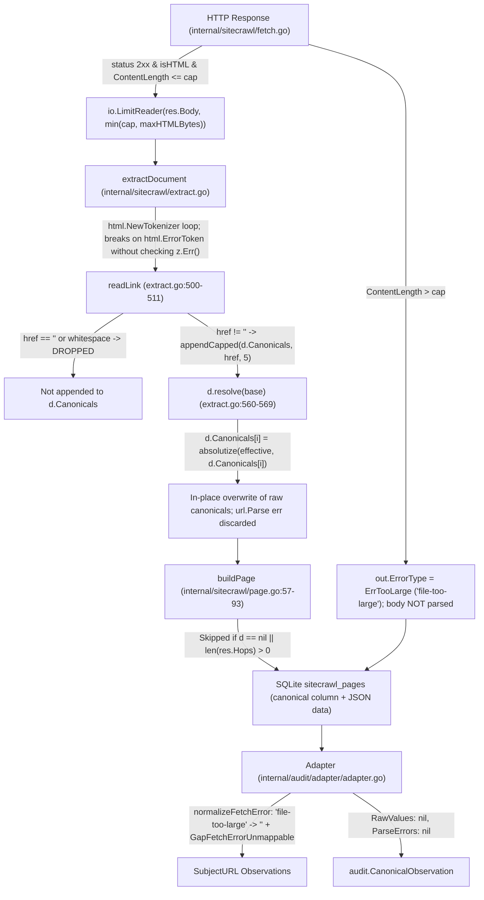

# Audit V1.9b: AR-CANON-005 Canonical Syntax Evidence Contract Review & Implementation Readiness

## 1. Executive Summary

- **Audit Milestone:** Audit V1.9b — Final Canonical Evidence Contract Correction & Implementation Readiness (`AR-CANON-005`)
- **Repository:** `truthrive/technical-seo-audit`
- **Branch:** `main`
- **Prior V1.9b Commit Baseline:** `f6d38019f4b7a59f1b1164d57a5a97dc2fdafea4`
- **Last Locked Design Baseline (V1.9a):** `a82a0691c13ae753ee52a1dcba2ec8e5bff1f0be`
- **NormalizationVersion:** Strictly `v1.9.0` (unchanged; zero normalization changes authorized in V1.9b)
- **Executable Rules:** Strictly `19 / 47` (unchanged; zero evaluators implemented or registered in V1.9b)
- **Remaining Rules:** Exactly `28 / 47`
- **Development Workflow:** **Risk-Based QA + Batch Implementation + MVP-First**
- **Milestone Type:** **Design-Only Contract Correction & Implementation-Readiness Specification**. Zero executable evaluator code, zero rule registrations, zero crawler modifications, zero SQLite schema diffs, zero adapter normalization alterations, and zero policy changes.

### 1.1 Objective & Strategic Context

Following the Audit V1.9a readiness review (`a82a0691c13ae753ee52a1dcba2ec8e5bff1f0be`) and the initial V1.9b contract draft (`f6d38019f4b7a59f1b1164d57a5a97dc2fdafea4`), technical verification of the SiteCrawl acquisition and Adapter normalization pipeline identified four critical source-completeness and raw-provenance gaps that invalidated the initial V1.9b heuristic (`http_status == 200 AND content_type contains html AND rendered != true AND fetch_error_type == ""`).

This corrected review resolves all V1.9b documentation blockers and provides an implementation-ready engineering proposal for `AR-CANON-005 — Canonical URL is syntactically resolvable` under the project's **Risk-Based QA + Batch Implementation + MVP-First** workflow by:
1. Separating canonical source completeness into four distinct technical layers and documenting the exact source-level limitations in `internal/sitecrawl/extract.go`, `internal/sitecrawl/fetch.go`, `internal/sitecrawl/page.go`, and `internal/audit/adapter/adapter.go`.
2. Finalizing evidence-backed contract recommendations for `DEC-V1.9A-001` (Canonical Failure Semantics), `DEC-V1.9A-002` (Source Completeness), and `DEC-V1.9A-003` (Raw Canonical Provenance).
3. Updating the 22-scenario verdict decision matrix to distinguish frozen expected verdicts, currently available evidence, missing evidence, current technical supportability, and required implementation prerequisites.
4. Defining an implementation-ready scope comparing **Scenario A (Adapter-only)** vs **Scenario B (Acquisition + Adapter + Evaluator)**, incorporating Risk-Based QA categorization and MVP-First delivery principles.

### 1.2 Status of Decisions

In strict adherence to governance principles, all contract recommendations in this document remain **PENDING EXTERNAL APPROVAL**. No contract decision is self-approved by the agent, and no production code changes are authorized until external approval is granted.

---

## 2. Baseline & Frozen Contract

### 2.1 Frozen Rule Definition

From `knowledge/07-v1-atomic-rule-manifest.md` (lines 346–360) and `internal/audit/rules_v1.json` (lines 655–692):

- **Rule ID:** `AR-CANON-005`
- **Name:** Canonical URL is syntactically resolvable
- **Parent Check:** `CANON-003`
- **Category:** `canonicalization`
- **Scope:** `url` (`EvaluationSubjectType`: `SubjectURL`)
- **Lifecycle:** `consolidate`
- **Automation:** `deterministic` (`PolicyMode`: `GLOBAL_DEFAULT`, `PolicyDependency`: `none`)
- **Default Severity:** `P1`
- **Source References:** `SRC-GOOGLE-CANONICAL-001`
- **Required Inputs:**
  1. `url` (Evaluation subject URL identity)
  2. `canonical_raw` (Raw un-normalized canonical declaration attribute string)
  3. `canonical_resolved_url` (Normalized/resolved HTTP(S) canonical target URL)
  4. `canonical_parse_error` (Diagnostic error string if parsing or resolution fails)
- **Preconditions:** `exactly one canonical declaration exists` (`canonical_count == 1`).

### 2.2 Frozen Verdict Semantics

| Condition | Status | Non-Negotiable Contract Meaning |
|---|---|---|
| Exactly one canonical declaration exists, and the value resolves to a valid HTTP(S) URL | **`PASS`** | Authoritative canonical target is syntactically valid and resolvable. |
| Exactly one canonical declaration exists, and the value cannot be resolved as a valid canonical URL | **`FAIL`** | Search engines cannot resolve the declared canonical target; consolidation signal is broken. |
| Canonical source cannot be read (or required evidence is incomplete/contradictory) | **`UNKNOWN`** | Diagnostic evidence is insufficient to prove either compliance or syntactic failure. |
| No single canonical declaration (`canonical_count == 0` or `canonical_count > 1`) | **`NOT_APPLICABLE`** | Precondition unsatisfied. Absence is evaluated by `AR-CANON-003`; multiplicity is evaluated by `AR-CANON-004`. |

*Frozen Invariant:* `WARNING` and `MANUAL_REVIEW` are **`not used`** for `AR-CANON-005`.

### 2.3 Non-Negotiable Architectural Principles

- `MISSING != FALSE`: Absence of an observation is never an observed negative value.
- `OBSERVATION != CONCLUSION`: Raw crawler and adapter observations remain strictly separated from rule verdicts.
- `URL DICTIONARY != FETCH`: Presence of a URL in `sitecrawl_urls` does not imply a completed page fetch.
- `INITIAL HTTP STATUS != TERMINAL HTTP STATUS`: Redirected pages (`len(res.Hops) > 0`) record initial 3xx status on `Page.Status` and suppress document extraction in `buildPage` (`internal/sitecrawl/page.go:57`).
- `SOURCE UNREADABLE != INVALID`: An unreadable, truncated, or unparsed HTML source must evaluate to `UNKNOWN`, never `FAIL` or `NOT_APPLICABLE`.
- `NORMALIZATION FAILURE != PROVEN SYNTAX FAILURE`: Aggregate normalization incompleteness (`canonical_normalization_complete=false`) does not by itself prove that the author's canonical declaration was syntactically invalid.

---

## 3. Source-to-Evidence Provenance Trace

Inspection of `internal/sitecrawl/fetch.go`, `internal/sitecrawl/extract.go`, `internal/sitecrawl/page.go`, `internal/sitecrawl/types.go`, and `internal/audit/adapter/adapter.go` establishes the exact runtime data flow:



### 3.1 Step 1: HTTP Fetch & Body Stream Bounding (`internal/sitecrawl/fetch.go`)

- **Size Gate Before Parse (`fetch.go:244–253`):**
  When `res.StatusCode >= 200 && res.StatusCode < 300 && isHTML(out.ContentType)` and `!opts.Render`:
  - If `res.ContentLength > cap` (where `cap = f.opts.maxFileSize()`), `fetch.go:246` sets `out.ErrorType = ErrTooLarge` (`"file-too-large"`), drains up to `drainCap`, and **skips `extractDocument` entirely** (`out.Doc` remains `nil`), while `out.Status` remains `200` and `out.ContentType` remains `"text/html"`.
- **Bounded Reader During Parse (`fetch.go:276–287`):**
  When `res.ContentLength <= cap` (or `ContentLength == -1` for chunked/unknown length), `fetch.go:276–279` sets:
  ```go
  limit := cap
  if maxHTMLBytes < limit {
      limit = maxHTMLBytes
  }
  counter := &countingReader{r: io.LimitReader(res.Body, limit)}
  doc, err := extractDocument(counter, finalURL)
  ```
  After `extractDocument` returns, `fetch.go:286` drains up to `drainCap` additional bytes (`io.Copy(io.Discard, io.LimitReader(res.Body, drainCap))`) and adds `extra` to `out.Size`, **without setting `out.ErrorType = ErrTooLarge` or recording any truncation flag** when `counter.n == limit` and `extra > 0`.

### 3.2 Step 2: HTML Tokenization & Link Extraction (`internal/sitecrawl/extract.go`)

- **Tokenizer Termination (`extract.go:172–176`):**
  ```go
  for {
      tt := z.Next()
      if tt == html.ErrorToken {
          break
      }
  ```
  `extractDocument` exits the tokenization loop on `html.ErrorToken` without inspecting `z.Err()`, and concludes by calling `d.resolve(base)` and returning `(d, nil)` (`extract.go:384–385`). Note that `extractDocument` **never returns a non-nil `err`** once `html.NewTokenizer` begins.
- **Base Href Capture (`extract.go:322–326`):**
  Captures the first non-empty `<base href="...">` into `d.BaseHref`.
- **Canonical Extraction (`extract.go:499–511`):**
  ```go
  func (d *document) readLink(attrs map[string]string) {
      rel := strings.ToLower(strings.TrimSpace(attrs["rel"]))
      href := strings.TrimSpace(attrs["href"])
      if rel == "" || href == "" {
          return
      }
      for _, token := range strings.Fields(rel) {
          switch token {
          case "canonical":
              d.Canonicals = appendCapped(d.Canonicals, href, 5)
          }
      }
  }
  ```
  Any `<link rel="canonical">` with missing `href`, `href=""`, or whitespace-only `href="   "` is silently ignored.

### 3.3 Step 3: In-Place Resolution & Absolutization (`internal/sitecrawl/extract.go`)

- **Base Resolution & Overwrite (`extract.go:560–569`):**
  ```go
  func (d *document) resolve(base *url.URL) {
      if base == nil {
          return
      }
      effective := base
      if d.BaseHref != "" {
          if b, err := base.Parse(d.BaseHref); err == nil && b.Host != "" {
              effective = b
          }
      }
      for i := range d.Canonicals {
          d.Canonicals[i] = absolutize(effective, d.Canonicals[i])
      }
  ```
- **Error Suppression in `absolutize` (`extract.go:595–604`):**
  ```go
  func absolutize(base *url.URL, raw string) string {
      if raw == "" {
          return ""
      }
      ref, err := url.Parse(strings.TrimSpace(raw))
      if err != nil {
          return raw
      }
      return base.ResolveReference(ref).String()
  }
  ```

### 3.4 Step 4: Page Construction & SQLite Persistence (`internal/sitecrawl/page.go`, `types.go`)

- **Redirect Exclusion (`page.go:57–59`):**
  `if d == nil || len(res.Hops) > 0 { return p }` — if the fetch involved any redirect hops, `buildPage` returns before copying `d.Canonicals`, leaving `p.Canonicals` empty on the redirected `Page` row.
- **Persisted Fields (`page.go:75–76`, `types.go:381–437`):**
  `p.Canonicals = d.Canonicals` and `p.Canonical = first(d.Canonicals)` store only post-absolutized strings. `d.BaseHref` is **not** copied to `Page` (`types.go:381–437`).

### 3.5 Step 5: Adapter Normalization (`internal/audit/adapter/adapter.go`)

- **Fetch Error Normalization (`adapter.go:678–697, 1640–1647`):**
  `normalizeFetchError` maps `"timeout"`, `"dns"`, `"tls"`, `"connect"`, `"http"`, `"redirect-loop"`, and `"too-many-redirects"`, but maps `"file-too-large"` (and `"crawl-delay"`, `"canceled"`, etc.) to `("", false)`. When `pr.errorType == "file-too-large"`, the Adapter records `GapFetchErrorUnmappable` (`adapter.go:689–696`) and **does not emit `fetch_error_type` on `SubjectURL`**.
- **Rendered Page Handling (`adapter.go:902–950`):**
  Emits `rendered = "true"` (`adapter.go:902`), records `GapRenderedRawSourceUnavailable`, and skips HTML canonical extraction (`adapter.go:935`).
- **Canonical Observation Emission (`adapter.go:1074–1225`):**
  Emits `canonical_count`, `canonical_resolved` (containing the post-absolutized `Page.Canonicals` entries), `canonical_normalized_target` (when `normalizeCanonicalTarget` succeeds), `canonical_normalization_complete` (`"true"` or `"false"`), and `canonical_distinct_normalized_count` (only when `canonical_normalization_complete == "true"`). In `audit.CanonicalObservation`, `RawValues` and `ParseErrors` are hardcoded to `nil` (`adapter.go:1129–1133`).

---

## 4. Correct Canonical Source Completeness (Four-Layer Analysis)

The initial V1.9b review proposed treating the derived predicate:

```text
http_status == 200
AND content_type contains html
AND rendered != true
AND fetch_error_type == ""
```

as sufficient proof of canonical source completeness. **That assumption is incorrect and is hereby withdrawn.**

HTTP transport eligibility does not prove that the HTML document body was completely read, that HTML extraction succeeded without truncation, or that canonical declarations were faithfully captured. Canonical source completeness must be separated into four distinct technical layers:

| Layer | Technical Responsibility | What It Proves | What It Cannot Prove |
|---|---|---|---|
| **Layer 1: HTTP Response / Transport Eligibility** | Server returned an initial 2xx HTML response header (`http_status == 200`, `isHTMLContentType(content_type)`, `rendered != true`, `redirect_chain_count == 0`). | The response headers indicate an unrendered HTML representation eligible for static extraction. | Cannot prove the response body was read, was within size limits, or was tokenized without error. |
| **Layer 2: HTML Body Read Completeness** | The response body stream (`res.Body`) was read to clean `io.EOF` (or at least past `</head>`) without transport read errors or `io.LimitReader` byte-cap truncation. | Bytes delivered by the server were fully received by the HTML tokenizer. | Cannot prove by `http_status == 200` or `fetch_error_type == ""` today because of Limitations 4.1, 4.2, and 4.3 below. |
| **Layer 3: HTML Extraction Completeness** | `extractDocument` tokenized the document `<head>` without hitting `ErrTooLarge`, redirect hop suppression (`len(res.Hops) > 0`), or declaration array cap truncation (`appendCapped(..., 5)`). | All `<link rel="canonical">` tags in the document were visited and retained. | Cannot prove whether empty/whitespace `href` declarations were dropped inside `readLink`. |
| **Layer 4: Canonical Declaration Readability** | Each `<link rel="canonical">` declaration's raw `href` presence, raw value, and `<base href>` resolution context were preserved without silent dropping or in-place overwrite. | The exact author-declared canonical syntax and resolution outcome can be inspected deterministically. | Cannot be proven from `canonical_count == 0` today because `extract.go:502` drops empty/whitespace `href` attributes (Limitation 4.4). |

### 4.1 Limitation 1: Mid-Stream HTML Read Errors (`internal/sitecrawl/extract.go`)

In `internal/sitecrawl/extract.go:172–176`, the streaming HTML tokenizer loop terminates as follows:

```go
for {
    tt := z.Next()
    if tt == html.ErrorToken {
        break
    }
    ...
}
```

In `golang.org/x/net/html`, `z.Next()` returns `html.ErrorToken` both on normal end-of-stream (`z.Err() == io.EOF`) **and** on any underlying `io.Reader` error (such as a TCP connection reset, TLS stream drop, server abort, or client body-read timeout after HTTP 200 headers were already received). Because `extractDocument` never inspects `z.Err()` and always returns `(d, nil)` (`extract.go:385`), and `fetch.go:280` only sets `out.ErrorType = classifyError(err)` when `extractDocument` returns a non-nil `err`, any mid-stream body read failure after HTTP 200 headers is **silently swallowed**:
- `out.Status` remains `200`.
- `out.ErrorType` remains `""`.
- `fetch_error_type` in `EvidenceSnapshot` remains `""`.
- If the stream dropped before `<link rel="canonical">` in `<head>`, `d.Canonicals` is empty (`canonical_count = 0`), masquerading as a page without a canonical tag.

### 4.2 Limitation 2: HTML Size Limit Truncation (`internal/sitecrawl/fetch.go`)

In `internal/sitecrawl/fetch.go:276–287`, HTML extraction is bounded by `io.LimitReader(res.Body, limit)` where `limit = min(f.opts.maxFileSize(), maxHTMLBytes)` (`maxHTMLBytes = 10 << 20`, or a lower user-configured `MaxSize`):

```go
limit := cap
if maxHTMLBytes < limit {
    limit = maxHTMLBytes
}
counter := &countingReader{r: io.LimitReader(res.Body, limit)}
doc, err := extractDocument(counter, finalURL)
out.Size = counter.n
if err != nil {
    out.ErrorType = classifyError(err)
    return out
}
extra, _ := io.Copy(io.Discard, io.LimitReader(res.Body, drainCap))
out.Size += extra
```

When an HTML response omits `Content-Length` (e.g., chunked transfer encoding) or declares `Content-Length <= cap` while `maxHTMLBytes < cap`, `io.LimitReader` silently returns `io.EOF` as soon as `limit` bytes are consumed. Even when `extra > 0` proves that additional body bytes existed beyond `limit`, the HTML branch (unlike the non-HTML branch at `fetch.go:258–260`) **never sets `out.ErrorType = ErrTooLarge` and records no truncation signal**. Consequently, an HTML stream truncated mid-document or mid-`<head>` produces `http_status == 200` and `fetch_error_type == ""` without a trustworthy completeness signal.

### 4.3 Limitation 3: Unmappable Fetch Errors (`internal/audit/adapter/adapter.go`)

When an HTML response declares `res.ContentLength > cap`, `internal/sitecrawl/fetch.go:245–249` sets `out.ErrorType = ErrTooLarge` (`"file-too-large"`) and **does not call `extractDocument` at all** (`out.Doc == nil`, `p.Canonicals == nil`).

However, in `internal/audit/adapter/adapter.go:1640–1647`, `normalizeFetchError` only maps `"timeout"`, `"dns"`, `"tls"`, `"connect"`, `"http"`, `"redirect-loop"`, and `"too-many-redirects"`. When `pr.errorType == "file-too-large"`, `adapter.go:679–696` executes:

```go
if normErr, ok := normalizeFetchError(pr.errorType); ok {
    emit(audit.SubjectURL, urlIDStr, "fetch_error_type", normErr)
} else {
    gaps = append(gaps, audit.EvidenceGap{
        ...
        GapCode: GapFetchErrorUnmappable,
        ...
    })
}
```

Because `EvidenceGap` records are appended to `EvidenceSnapshot.Gaps` and are **not** indexed as `SubjectURL` observations in `engine.EvidenceIndex`, an evaluator inspecting `SubjectURL` observations sees:
- `http_status == "200"`
- `content_type == "text/html..."`
- `rendered` absent (`!= "true"`)
- `fetch_error_type` absent (`== ""`)
- `canonical_count == "0"`

Thus, a missing `fetch_error_type` **cannot** prove that HTML acquisition even ran, let alone completed successfully.

### 4.4 Limitation 4: Silently Dropped Empty Canonical Declarations (`internal/sitecrawl/extract.go`)

In `internal/sitecrawl/extract.go:500–504`:

```go
rel := strings.ToLower(strings.TrimSpace(attrs["rel"]))
href := strings.TrimSpace(attrs["href"])
if rel == "" || href == "" {
    return
}
```

Whenever a page contains `<link rel="canonical">`, `<link rel="canonical" href="">`, or `<link rel="canonical" href="   ">`, `readLink` returns early before `appendCapped(d.Canonicals, href, 5)`. As a result:
- A page with a single empty canonical declaration (`<link rel="canonical" href="">`) produces `canonical_count == 0` instead of `canonical_count == 1` with an empty-syntax failure.
- Under `AR-CANON-005`, `canonical_count == 0` would falsely evaluate to `NOT_APPLICABLE` instead of `FAIL`.
- Furthermore, if a page has two canonical tags—one valid (`href="https://example.com/a"`) and one empty (`href=""`)—dropping the empty tag makes `canonical_count == 1` instead of `2`, hiding multiplicity (`AR-CANON-004`) and misrouting the page into `AR-CANON-005`!

### 4.5 Corrected Completeness Contract Proposal

To establish canonical source completeness without relying on the flawed HTTP 200 heuristic, the pipeline requires an explicit, provenance-backed completeness signal (`canonical_source_complete` or `html_extraction_complete`) emitted only when **all** of the following hold:
1. **Layer 1 (Transport & Redirect Eligibility):** `res.StatusCode >= 200 && res.StatusCode < 300`, `isHTML(out.ContentType)`, `!opts.Render`, and `len(res.Hops) == 0` (the evaluated `Page` represents a direct terminal 2xx HTML fetch, not an initial 3xx hop where `buildPage` discards `res.Doc`).
2. **Layer 2 (Clean Stream EOF & Uncapped Read):** `extractDocument` inspects `z.Err()` on `html.ErrorToken` and confirms `z.Err() == io.EOF` **and** the reader did not hit the `io.LimitReader` cap (`extra == 0` / `!truncated`) **and** `pr.errorType == ""` (no `file-too-large` or other unmappable crawler error occurred).
3. **Layer 3 & Layer 4 (Complete Link Tokenization):** `readLink` records all `<link rel="canonical">` tags regardless of whether `href` is empty or whitespace-only, preserving accurate `canonical_count` and raw attribute state.

---

## 5. Finalized Contract Recommendations

### 5.1 DEC-V1.9A-001 — Canonical Failure Semantics

**Decision Question:** What is the minimum evidence required for `AR-CANON-005` to return `PASS`, `FAIL`, `UNKNOWN`, and `NOT_APPLICABLE`, and how must syntax/resolution failures be represented?

#### Minimum Evidence Requirements by Verdict

| Verdict | Minimum Required Evidence on `SubjectURL` | Rationale |
|---|---|---|
| **`PASS`** | `canonical_source_complete == "true"` AND `canonical_count == "1"` AND `canonical_syntax_status == "valid"` AND `canonical_normalized_target != ""` (valid absolute `http` or `https` URL with non-empty host) | Proves source was readable, exactly one canonical tag existed, and it resolved cleanly (directly or via valid `<base href>`) to a valid HTTP(S) canonical URL. |
| **`FAIL`** | `canonical_source_complete == "true"` AND `canonical_count == "1"` AND `canonical_syntax_status == "invalid"` AND `canonical_parse_error != ""` (proven syntax/resolution error code) | Proves source was readable, exactly one canonical tag existed, and the declaration failed syntax or reference resolution for a specific, auditable reason. |
| **`NOT_APPLICABLE`** | `canonical_source_complete == "true"` AND (`canonical_count == "0"` OR `canonical_count > "1"`) | Proves source was readable and the single-canonical precondition (`canonical_count == 1`) does not hold. |
| **`UNKNOWN`** | `canonical_source_complete != "true"` (e.g. non-200 status, fetch error, `file-too-large`, mid-stream read error, size-limit truncation, `rendered == "true"`, redirected `Page` without `Doc`) OR `url_identity` missing/conflicting OR observation conflict OR (`canonical_count == "1"` AND `canonical_normalization_complete == "false"` without a proven `canonical_parse_error`) | Preserves `SOURCE UNREADABLE != INVALID` and `NORMALIZATION FAILURE != PROVEN SYNTAX FAILURE`. |

#### Explicit Syntax / Resolution Diagnostic Taxonomy (`canonical_parse_error`)

`FAIL` must **never** be inferred from `canonical_normalization_complete == "false"` alone. Instead, when `canonical_count == 1`, explicit diagnostic codes must classify proven author declaration failures:
- `empty_href`: `<link rel="canonical">` has missing `href`, `href=""`, or whitespace-only `href`.
- `malformed_url`: Raw canonical `href` fails RFC 3986 / `url.Parse` parsing (e.g. invalid control characters, bad port `https://example.com:abc`, unclosed IPv6 bracket `http://[::1`, invalid percent-encoding).
- `invalid_base_href`: Raw canonical `href` is a relative reference, `<base href>` is present on the page, and `<base href>` either fails `url.Parse` or resolves without a valid scheme/host (`b.Host == ""` or scheme not `http`/`https`).
- `unsupported_scheme`: Resolved canonical URL uses a non-HTTP(S) scheme (e.g. `javascript:`, `mailto:`, `tel:`, `ftp:`, `data:`, `file:`).
- `missing_host`: Resolved canonical URL has `http` or `https` scheme but an empty or invalid host (e.g. `https:///path`, `http://:80/path`).

#### Decision Summary (`DEC-V1.9A-001`)

- **Recommended Option:** **Option B — Explicit Syntax and Resolution Diagnostics (`canonical_syntax_status` + `canonical_parse_error`)**, with `UNKNOWN` fallback whenever normalization is incomplete without a proven syntax/resolution error.
- **Evidence:** `internal/audit/adapter/adapter.go:1129–1181` sets `ParseErrors: nil` and collapses all normalization failures into `canonical_normalization_complete = "false"`. Frozen manifest `knowledge/07-v1-atomic-rule-manifest.md:346–360` and `internal/audit/rules_v1.json:664–669` explicitly require `canonical_parse_error`.
- **Risks:** If Option A (inferring `FAIL` from `canonical_normalization_complete == "false"`) were used, internal normalizer edge cases or missing base context would emit false-positive `P1 FAIL` verdicts. Option B eliminates this risk.
- **Implementation Impact:** Requires capturing raw canonical declarations and `<base href>` state in SiteCrawl (`extract.go`, `page.go`, `types.go`) and emitting `canonical_raw`, `canonical_syntax_status`, and `canonical_parse_error` in Adapter (`adapter.go`) before/with `evaluateCANON005`.
- **Required Tests:** Unit tests covering all 5 error codes (`empty_href`, `malformed_url`, `invalid_base_href`, `unsupported_scheme`, `missing_host`), plus a safeguard test verifying that `canonical_normalization_complete == "false"` without `canonical_parse_error` returns `UNKNOWN`.
- **Approval State:** **PENDING EXTERNAL APPROVAL**.

---

### 5.2 DEC-V1.9A-002 — Canonical Source Completeness

**Decision Question:** How should the pipeline prove that the canonical source is complete and readable so that `AR-CANON-005` never confuses an unreadable/truncated source with `NOT_APPLICABLE` or `FAIL`?

#### Comparison of Approaches

| Approach | Description | Technical Defensibility | Verdict Accuracy Impact |
|---|---|---|---|
| **Option A: Derived Transport Eligibility** | Infer completeness from `http_status == 200 AND content_type contains html AND rendered != true AND fetch_error_type == ""`. | **Defective / Rejected.** Fails on `file-too-large` (`adapter.go:1640`), mid-stream `z.Err()` read errors (`extract.go:172`), `io.LimitReader` truncation (`fetch.go:279`), and dropped empty `href=""` (`extract.go:502`). | Misclassifies `file-too-large` and truncated responses as readable (`NOT_APPLICABLE` when `count == 0`). |
| **Option B: Typed Source-Completeness Evidence (Recommended)** | Record actual HTML stream read and extraction completion in SiteCrawl (`z.Err() == io.EOF`, not truncated at `io.LimitReader` cap, `pr.errorType == ""`, `!rendered`, `len(res.Hops) == 0`) and emit `canonical_source_complete` (`"true"` / `"false"`) in Adapter. | **High / Recommended.** Directly reflects Layer 1–4 acquisition reality rather than repackaging HTTP 200 status. | Accurately routes `file-too-large`, mid-stream read errors, and truncated HTML bodies to `UNKNOWN`. |
| **Option C: Conservative `UNKNOWN` Without Acquisition Fix** | Return `UNKNOWN` whenever `canonical_count == 0` or `canonical_normalization_complete == "false"` because current acquisition cannot prove completeness. | **Low / Over-Conservative.** Would prevent returning `NOT_APPLICABLE` on normal pages without canonicals or `FAIL` on broken canonicals. | Blocks meaningful evaluation of `AR-CANON-005`. |

#### Decision Summary (`DEC-V1.9A-002`)

- **Recommended Option:** **Option B — Explicit, Provenance-Backed Source Completeness (`canonical_source_complete`)**. Specifically:
  1. In `internal/sitecrawl/extract.go:172–176`, inspect `z.Err()` when `tt == html.ErrorToken`; if `z.Err() != nil && z.Err() != io.EOF`, return the error so `fetch.go` classifies it as a fetch/read error (`DocReadError`).
  2. In `internal/sitecrawl/fetch.go:276–287`, track whether the HTML stream hit `limit` with remaining unread bytes (`counter.n == limit && extra > 0`) and record `HTMLTruncated: true` (or `DocComplete: true` only when `err == nil && !truncated`).
  3. In `internal/audit/adapter/adapter.go`, emit `canonical_source_complete = "true"` on `SubjectURL` **only** when `pr.status >= 200 && pr.status < 300`, `isHTMLContentType(pr.contentType)`, `!isRendered`, `pr.errorType == ""` ( checked on raw `pr.errorType`, not just normalized `fetch_error_type`, catching `"file-too-large"`), `len(pr.page.Redirects) == 0`, and `pr.page.HTMLComplete` (or equivalent clean-EOF / non-truncated provenance) is true. Otherwise emit `canonical_source_complete = "false"`.
- **Evidence:** Directly addresses Limitations 4.1 (`extract.go:172`), 4.2 (`fetch.go:279`), 4.3 (`adapter.go:679, 1640`), and 4.4 (`extract.go:502`). Does **not** merely repackage the unreliable HTTP 200 predicate into a boolean.
- **Risks:** Backward-compatibility with legacy SQLite crawl runs whose `sitecrawl_pages.data` JSON predates `HTMLComplete`. Mitigation: if a legacy SQLite row lacks the new JSON field, Adapter can distinguish legacy schema state or require crawl runs produced under the updated acquisition contract.
- **Implementation Impact:** Small, targeted additions in `internal/sitecrawl/extract.go`, `internal/sitecrawl/fetch.go`, `internal/sitecrawl/page.go`, `internal/sitecrawl/types.go`, and `internal/audit/adapter/adapter.go`.
- **Required Tests:**
  - Mid-stream `io.Reader` error after HTTP 200 headers -> `canonical_source_complete == "false"` -> `AR-CANON-005` returns `UNKNOWN`.
  - HTML body exceeding `maxHTMLBytes` / `MaxSize` via `io.LimitReader` -> `canonical_source_complete == "false"` -> `AR-CANON-005` returns `UNKNOWN`.
  - `pr.errorType == "file-too-large"` -> `canonical_source_complete == "false"` -> `AR-CANON-005` returns `UNKNOWN`.
  - Rendered page (`rendered == "true"`) -> `canonical_source_complete == "false"` -> `AR-CANON-005` returns `UNKNOWN`.
- **Approval State:** **PENDING EXTERNAL APPROVAL**.

---

### 5.3 DEC-V1.9A-003 — Raw Canonical Provenance

**Decision Question:** What information is permanently lost by `d.Canonicals[i] = absolutize(effective, d.Canonicals[i])` and `readLink`, can Adapter-only wiring satisfy the frozen `AR-CANON-005` contract, and what SiteCrawl acquisition/persistence changes are required?

#### Verification of Information Permanently Lost in `internal/sitecrawl/extract.go`

In `internal/sitecrawl/extract.go:500–511` (`readLink`), `560–569` (`resolve`), and `595–604` (`absolutize`):

```go
effective := base
if d.BaseHref != "" {
    if b, err := base.Parse(d.BaseHref); err == nil && b.Host != "" {
        effective = b
    }
}
for i := range d.Canonicals {
    d.Canonicals[i] = absolutize(effective, d.Canonicals[i])
}
```

| Case | Author HTML Input | Runtime Behavior in `extract.go` & `page.go` | Information Permanently Lost Before SQLite Persistence | Can Adapter-Only Wiring Satisfy Frozen Contract? |
|---|---|---|---|---|
| **1. Empty / whitespace canonical declarations** | `<link rel="canonical" href="">`, `<link rel="canonical" href="   ">`, or `<link rel="canonical">` | `readLink` (`extract.go:502`) executes `if rel == "" \|\| href == "" { return }`. Nothing is appended to `d.Canonicals`. | **Total loss of tag existence.** `Page.Canonicals` has length `0` (`canonical_count = 0`). Cannot distinguish from a page with no canonical tag. | **No.** Adapter sees `len(canonicals) == 0` and would return `NOT_APPLICABLE` instead of `FAIL`. |
| **2. Relative canonical values** | `<link rel="canonical" href="/products/item">` on `https://example.com/shop/page` | `absolutize` resolves `/products/item` against `effective` and overwrites `d.Canonicals[0]` in-place with `"https://example.com/products/item"`. | **Original raw string (`"/products/item"`) is overwritten.** `Page.Canonicals` only contains the post-absolutized URL; `CanonicalObservation.RawValues` is `nil`. | **Partial (for `PASS` only, not `canonical_raw` provenance).** The resolved URL is valid, but `canonical_raw` required by `rules_v1.json:666` is unavailable. |
| **3. Effective `<base href>` & invalid `<base href>`** | `<base href="http://[::1">` (or `<base href="/relative-no-host">` or `<base href="javascript:alert(1)">`) + `<link rel="canonical" href="page.html">` | In `extract.go:562–565`, if `base.Parse(d.BaseHref)` returns an error or `b.Host == ""` (or non-HTTP scheme), `resolve` **silently ignores `d.BaseHref`** and falls back to `effective = base` (the page's own URL)! Furthermore, `d.BaseHref` is never copied to `Page` in `page.go`. | **Total loss of `<base href>` value and `<base href>` failure.** A relative canonical combined with a broken `<base href>` is silently resolved against the request URL and appears as a valid absolute URL (`PASS` instead of `FAIL`)! | **No.** Adapter has zero visibility into `<base href>` or the fact that `<base href>` failed and fell back to the page URL. |
| **4. Invalid URL syntax** | `<link rel="canonical" href="http://[::1">` or `href="https://example.com:badport/a"` | `url.Parse` in `absolutize` (`extract.go:599`) fails and returns `raw` unchanged. However, for inputs like `href="http:///path"` or `href="relative path with spaces"`, `url.Parse` or `ResolveReference` may percent-encode or alter the string before storing in `d.Canonicals[i]`. | **Pre-resolution raw string and exact failure stage (raw parse vs base resolution) are conflated or mutated.** | **Partial.** Explicitly broken strings that survive `absolutize` fail in `normalizeCanonicalTarget`, but inputs repaired/mutated by `ResolveReference` lose raw syntax state. |
| **5. Parsing errors** | Any input causing `url.Parse` error in `absolutize` (`extract.go:599–601`) or `base.Parse(d.BaseHref)` (`extract.go:563`) | Both `err` values are discarded without logging or storing in `document` or `Page`. | **Exact parser error diagnostics are discarded.** | **Partial.** Adapter must re-parse `Page.Canonicals[i]` and cannot see `base.Parse` errors at all. |

#### Verdict on Adapter-Only Feasibility

**Adapter-only wiring CANNOT satisfy the frozen `AR-CANON-005` contract.** Specifically, an Adapter-only implementation:
1. **Cannot detect empty or whitespace-only canonical declarations** (Scenarios 9 & 10), falsely returning `NOT_APPLICABLE` instead of `FAIL`.
2. **Cannot detect relative canonicals broken by an invalid `<base href>`** (Scenario 6), falsely returning `PASS` because `extract.go:563` silently falls back to the page URL when `<base href>` is invalid.
3. **Cannot populate true `canonical_raw` provenance** (`rules_v1.json:666`, `CanonicalObservation.RawValues`), because `extract.go:568` overwrites `d.Canonicals` in-place.
4. **Cannot distinguish clean HTML extraction from mid-stream read errors or `io.LimitReader` truncation** (Scenario 15).

#### Recommended SiteCrawl Acquisition & Persistence Changes (`DEC-V1.9A-003`)

To preserve raw provenance without breaking existing callers of `Page.Canonical` and `Page.Canonicals`:
1. **`internal/sitecrawl/extract.go`:**
   - In `readLink` (`extract.go:500–511`), inspect `rel` tokens first. When `rel` contains `"canonical"`, record the raw `attrs["href"]` value (even if empty `""` or whitespace-only) into `d.RawCanonicals` (capped at 5), and preserve existing `d.Canonicals` behavior for non-empty declarations (or align counts while keeping `Page.Canonical` non-empty for backward compatibility with crawl consumers).
   - Preserve `d.BaseHref` on `document` and copy it to `Page.BaseHref` (`json:"base_href,omitempty"` in `internal/sitecrawl/types.go` and `internal/sitecrawl/page.go`).
   - Do **not** silently fall back to `base` for canonical resolution when `d.BaseHref != ""` is invalid; or, since `RawCanonicals` and `BaseHref` are persisted on `Page`, perform deterministic canonical resolution and syntax validation in the Adapter using `(pr.url, pr.page.BaseHref, pr.page.RawCanonicals)`.
2. **SQLite Persistence (`internal/sitecrawl/runs.go`, `persist.go`):**
   - **Zero SQLite DDL / table column changes required.** `sitecrawl_pages.data` already stores the JSON-serialized `sitecrawl.Page` struct (`persist.go:65`), and `internal/audit/adapter/adapter.go:467` already unmarshals `sitecrawl_pages.data` into `pr.page` (`sitecrawl.Page`). Adding `RawCanonicals []string` (`json:"raw_canonicals,omitempty"`), `BaseHref string` (`json:"base_href,omitempty"`), and `HTMLComplete bool` (`json:"html_complete,omitempty"`) to `sitecrawl.Page` persists them automatically in `sitecrawl_pages.data`.
3. **Adapter Normalization (`internal/audit/adapter/adapter.go`):**
   - Populate `CanonicalObservation.RawValues` and `CanonicalObservation.ParseErrors`.
   - Emit `canonical_raw`, `canonical_syntax_status`, `canonical_parse_error`, and `canonical_source_complete` on `SubjectURL`.

#### Decision Summary (`DEC-V1.9A-003`)

- **Recommended Option:** **Option B — Preserve Raw Canonical Declarations (`RawCanonicals`) and `<base href>` (`BaseHref`) in SiteCrawl `Page` JSON + Adapter Diagnostic Wiring.**
- **Evidence:** Proven by `internal/sitecrawl/extract.go:502` (empty `href` dropped), `extract.go:562–569` (silent fallback on invalid `<base href>` and in-place overwrite of `d.Canonicals`), and `internal/audit/adapter/adapter.go:1129–1133` (`RawValues: nil, ParseErrors: nil`).
- **Risks:** Adding empty canonical tags directly to `Page.Canonicals` could affect legacy callers expecting `Page.Canonicals` to contain only non-empty URLs. Mitigation: keep `RawCanonicals []string` as the authoritative raw declaration slice used by the Adapter (when present on `Page`), and ensure `canonical_count` in the Adapter reflects all `<link rel="canonical">` declarations including empty `href=""` tags, while verifying zero regression in `AR-CANON-003`, `AR-CANON-004`, `AR-CANON-006`, and `AR-CANON-007`.
- **Implementation Impact:** Coordinated update across `internal/sitecrawl/extract.go`, `internal/sitecrawl/fetch.go`, `internal/sitecrawl/page.go`, `internal/sitecrawl/types.go`, and `internal/audit/adapter/adapter.go`. Zero SQLite table schema migration needed.
- **Required Tests:**
  - `<link rel="canonical" href="">` and `<link rel="canonical" href="   ">` -> `canonical_count == 1`, `canonical_raw == ""`, `canonical_parse_error == "empty_href"` -> `AR-CANON-005` returns `FAIL`.
  - Relative canonical `href="sub/page"` with valid `<base href="https://example.com/dir/">` -> `canonical_raw == "sub/page"`, `canonical_normalized_target == "https://example.com/dir/sub/page"` -> `AR-CANON-005` returns `PASS`.
  - Relative canonical `href="sub/page"` with invalid `<base href="http://[::1">` or hostless `<base href="mailto:test@example.com">` -> `canonical_parse_error == "invalid_base_href"` -> `AR-CANON-005` returns `FAIL`.
- **Approval State:** **PENDING EXTERNAL APPROVAL**.

---

## 6. Updated 22-Scenario Verdict Decision Matrix

The following 22-scenario matrix preserves every scenario from the V1.9b review and explicitly distinguishes:
1. **Expected Verdict (Frozen Semantics)**
2. **Evidence Currently Available (at `f6d38019f4b7a59f1b1164d57a5a97dc2fdafea4`)**
3. **Evidence Currently Missing**
4. **Definitive Verdict Technically Supportable Today?**
5. **Required Implementation Prerequisite**

| # | Scenario | Expected Verdict (Frozen Semantics) | Evidence Currently Available | Evidence Missing | Definitive Verdict Supportable Today? | Required Implementation Prerequisite |
|---|---|---|---|---|---|---|
| 1 | No canonical declaration (`0` `<link rel="canonical">` tags in complete HTML) | **`NOT_APPLICABLE`** | `canonical_count == "0"`, `http_status == "200"`, `content_type` | `canonical_source_complete` (cannot distinguish from `file-too-large`, truncated HTML, or dropped empty `href=""`) | **No (Ambiguous with #9, #10, #15)** | **Scenario B:** SiteCrawl empty-href capture (`extract.go:502`) + `canonical_source_complete` (`DEC-V1.9A-002` & `DEC-V1.9A-003`) |
| 2 | Exactly one valid absolute HTTP canonical URL (`http://example.com/page`) | **`PASS`** | `canonical_count == "1"`, `canonical_resolved`, `canonical_normalized_target`, `canonical_normalization_complete == "true"` | `canonical_raw` (identical to resolved for absolute URL, but field not emitted), `canonical_source_complete` | **Partial (Target valid, but `canonical_raw` & completeness signal absent)** | **Scenario B:** Emit `canonical_raw`, `canonical_source_complete`, `canonical_syntax_status` + `evaluateCANON005` |
| 3 | Exactly one valid absolute HTTPS canonical URL (`https://example.com/page`) | **`PASS`** | `canonical_count == "1"`, `canonical_resolved`, `canonical_normalized_target`, `canonical_normalization_complete == "true"` | `canonical_raw`, `canonical_source_complete` | **Partial (Target valid, but `canonical_raw` & completeness signal absent)** | **Scenario B:** Emit `canonical_raw`, `canonical_source_complete`, `canonical_syntax_status` + `evaluateCANON005` |
| 4 | Exactly one valid relative canonical URL (`href="/about"`) with no `<base href>` | **`PASS`** | `canonical_count == "1"`, `canonical_resolved` (post-absolutized), `canonical_normalized_target`, `canonical_normalization_complete == "true"` | `canonical_raw` (raw `"/about"` overwritten in-place at `extract.go:568`), `canonical_source_complete` | **Partial (Target resolves, but raw relative value lost)** | **Scenario B:** Preserve `RawCanonicals` in `extract.go` & emit `canonical_raw` (`DEC-V1.9A-003`) |
| 5 | Relative canonical URL (`href="sub"`) with valid `<base href="https://example.com/dir/">` | **`PASS`** | `canonical_count == "1"`, `canonical_resolved` (post-absolutized), `canonical_normalized_target`, `canonical_normalization_complete == "true"` | `canonical_raw` (`"sub"` overwritten), ` BaseHref` not stored on `Page`, `canonical_source_complete` | **Partial (Target resolves, but raw & base provenance lost)** | **Scenario B:** Preserve `RawCanonicals` and `BaseHref` on `Page` (`DEC-V1.9A-003`) |
| 6 | Relative canonical URL (`href="sub"`) with missing or invalid `<base href="http://[::1">` | **`FAIL`** | `canonical_count == "1"`, **false `canonical_normalization_complete == "true"`** when `extract.go:563` silently ignores invalid `d.BaseHref` and resolves against request URL! | `BaseHref` persistence, invalid-base detection (`invalid_base_href`), `canonical_raw` | **No (Silently produces false `PASS` today!)** | **Scenario B:** Persist `BaseHref` & `RawCanonicals`; fail resolution when `BaseHref` is present but invalid (`DEC-V1.9A-001` & `DEC-V1.9A-003`) |
| 7 | Canonical using unsupported scheme (`javascript:void(0)`, `mailto:a@b.com`, `ftp://...`) | **`FAIL`** | `canonical_count == "1"`, `canonical_resolved`, `canonical_normalization_complete == "false"` | `canonical_parse_error == "unsupported_scheme"`, `canonical_raw`, `canonical_source_complete` | **No (Only untyped `complete == "false"` exists)** | **Scenario B:** Emit `canonical_parse_error` (`unsupported_scheme`) in Adapter (`DEC-V1.9A-001`) |
| 8 | Canonical containing malformed URL syntax (`http://[::1`, `https://example.com:badport`) | **`FAIL`** | `canonical_count == "1"`, `canonical_resolved`, `canonical_normalization_complete == "false"` | `canonical_parse_error == "malformed_url"`, `canonical_raw`, `canonical_source_complete` | **No (Parse error discarded in `absolutize` and `normalizeCanonicalTarget`)** | **Scenario B:** Preserve `RawCanonicals` & emit `canonical_parse_error` (`malformed_url`) (`DEC-V1.9A-001` & `DEC-V1.9A-003`) |
| 9 | Empty canonical declaration (`<link rel="canonical" href="">` or missing `href`) | **`FAIL`** | **None (`canonical_count == "0"`)** because `extract.go:502` drops empty `href` | Raw empty canonical tag capture, `canonical_count == "1"`, `canonical_parse_error == "empty_href"` | **No (Falsely appears as `canonical_count == 0` today!)** | **Scenario B:** Capture empty `href` canonical tags in `extract.go:500–511` (`DEC-V1.9A-001` & `DEC-V1.9A-003`) |
| 10 | Whitespace-only canonical declaration (`<link rel="canonical" href="   ">`) | **`FAIL`** | **None (`canonical_count == "0"`)** because `extract.go:501–502` trims and drops whitespace `href` | Raw whitespace canonical tag capture, `canonical_count == "1"`, `canonical_parse_error == "empty_href"` | **No (Falsely appears as `canonical_count == 0` today!)** | **Scenario B:** Capture whitespace-only `href` canonical tags in `extract.go:500–511` (`DEC-V1.9A-001` & `DEC-V1.9A-003`) |
| 11 | Multiple distinct canonical declarations (`canonical_count > 1`, distinct targets) | **`NOT_APPLICABLE`** | `canonical_count > "1"` (unless one of two tags had `href=""` and was dropped) | Empty-href retention (so `[valid, ""]` has `count == 2`), `canonical_source_complete` | **Partial (Supported when all tags are non-empty; broken if 1 of 2 tags is empty)** | **Scenario B:** Empty-href retention in `extract.go` + `evaluateCANON005` precondition check |
| 12 | Duplicate identical canonical declarations (`canonical_count > 1`, identical targets) | **`NOT_APPLICABLE`** | `canonical_count > "1"`, `canonical_distinct_normalized_count == "1"` | `canonical_source_complete` | **Yes (once `evaluateCANON005` is implemented)** | `evaluateCANON005` (`canonical_count > 1` -> `NOT_APPLICABLE`) |
| 13 | Canonical source unavailable (non-HTML `content_type`, e.g. `application/pdf`, `image/png`) | **`UNKNOWN`** | `http_status`, `content_type` (non-HTML), `canonical_count == "0"` | `canonical_source_complete == "false"` | **Yes (via `content_type` / `canonical_source_complete`)** | Emit `canonical_source_complete == "false"` for non-HTML responses (`DEC-V1.9A-002`) |
| 14 | HTTP fetch failed (connection error, DNS/TLS/timeout, HTTP 4xx/5xx, or redirect hop row) | **`UNKNOWN`** | `fetch_error_type != ""` (for mappable errors) or `http_status != "200"` | Unmappable fetch error handling (`file-too-large` has `fetch_error_type == ""` and `http_status == "200"`), `canonical_source_complete` | **Partial (Mappable errors & non-200 supported; `file-too-large` is NOT)** | **Scenario B:** Gate `canonical_source_complete` on raw `pr.errorType == ""` and `len(pr.page.Redirects) == 0` (`DEC-V1.9A-002`) |
| 15 | HTTP 200 HTML response, but body extraction incomplete / truncated / mid-stream read error | **`UNKNOWN`** | `http_status == "200"`, `content_type == "text/html"`, `fetch_error_type == ""` | `z.Err()` check in `extract.go:172`, `io.LimitReader` truncation check in `fetch.go:279`, `file-too-large` gate, `canonical_source_complete == "false"` | **No (Indistinguishable from a complete 200 HTML page today!)** | **Scenario B:** Inspect `z.Err()` in `extract.go`, detect `io.LimitReader` cap in `fetch.go`, emit `canonical_source_complete` (`DEC-V1.9A-002`) |
| 16 | Rendered page without retained raw server HTML (`rendered == "true"`) | **`UNKNOWN`** | `rendered == "true"` on `SubjectURL`, `GapRenderedRawSourceUnavailable` | None (`rendered == "true"` is already emitted at `adapter.go:902`) | **Yes (once `evaluateCANON005` is implemented)** | `canonical_source_complete == "false"` when `rendered == "true"` + `evaluateCANON005` (`DEC-V1.9A-002`) |
| 17 | Single canonical where normalization succeeds (`canonical_normalization_complete == "true"`) and `<base href>` (if any) is valid | **`PASS`** | `canonical_count == "1"`, `canonical_normalization_complete == "true"`, `canonical_normalized_target != ""` | Verification that `<base href>` did not silently fail (`extract.go:563`), `canonical_source_complete == "true"`, `canonical_raw` | **Partial (Safe when no invalid `<base href>` was present)** | **Scenario B:** Validate `<base href>` + emit `canonical_syntax_status == "valid"` (`DEC-V1.9A-001` & `DEC-V1.9A-003`) |
| 18 | Single canonical where normalization fails with a proven syntax/resolution error | **`FAIL`** | `canonical_count == "1"`, `canonical_normalization_complete == "false"` | Typed `canonical_parse_error` and `canonical_syntax_status == "invalid"` | **No (Cannot distinguish proven syntax failure from untyped normalization failure)** | **Scenario B:** Emit `canonical_syntax_status == "invalid"` and `canonical_parse_error` (`DEC-V1.9A-001`) |
| 19 | Single canonical where normalization fails without a proven syntax cause (e.g. missing subject URL context or internal normalizer uncertainty) | **`UNKNOWN`** | `canonical_count == "1"`, `canonical_normalization_complete == "false"` | Distinction between proven syntax error (`canonical_parse_error != ""`) and unproven failure (`canonical_parse_error == ""`) | **Yes (Conservative `UNKNOWN` fallback when `canonical_parse_error == ""`)** | **Scenario B:** Evaluator returns `UNKNOWN` if `canonical_normalization_complete == "false"` and `canonical_parse_error == ""` (`DEC-V1.9A-001`) |
| 20 | Conflicting canonical observations on `SubjectURL` (e.g. contradictory `canonical_count`, `canonical_source_complete`, or `canonical_syntax_status`) | **`UNKNOWN`** | `EvidenceIndex` multi-observation slice per field on `SubjectURL` | Evaluator conflict checks on new canonical syntax observations | **Yes (Engine pattern established)** | Standard single-value conflict check in `evaluateCANON005` |
| 21 | Missing required subject evidence (`url_identity` missing or conflicting on `SubjectURL`) | **`UNKNOWN`** | `EvidenceIndex` `url_identity` lookup | None | **Yes (Engine pattern established)** | Standard `url_identity` validation in `evaluateCANON005` |
| 22 | Cross-run or invalid subject correlation (`AuditRunID` or `SnapshotID` mismatch) | **`UNKNOWN`** | `EvidenceIndex` run/snapshot validation in `internal/audit/engine/evidence.go` | None | **Yes (Engine pattern established)** | Handled by `EvidenceIndex` and `evaluateCANON005` |

*Verdict Matrix Invariant Verification:*
- Zero scenarios with unreadable, truncated, unmappable (`file-too-large`), or rendered sources evaluate to `FAIL` or `NOT_APPLICABLE`; all evaluate to **`UNKNOWN`** (#13, #14, #15, #16, #19, #20, #21, #22).
- Zero scenarios requiring raw provenance, empty-href capture, invalid-base detection, or body-read completeness (#1, #6, #7, #8, #9, #10, #15, #18) are falsely marked as fully supported today.

---

## 7. Implementation-Ready Scope: Scenario A vs Scenario B & Milestone Consolidation

### 7.1 Comparison: Scenario A (Adapter-Only) vs Scenario B (Acquisition + Adapter + Evaluator)

| Dimension | Scenario A: Adapter-Only Implementation | Scenario B: Acquisition + Adapter + Evaluator (Recommended) |
|---|---|---|
| **Core Architecture Scope** | Modifies only `internal/audit/adapter/` and `internal/audit/engine/`. Leaves `internal/sitecrawl/` untouched. | Coordinated update across `internal/sitecrawl/` (acquisition), `internal/audit/adapter/` (normalization), and `internal/audit/engine/` (evaluator). |
| **Required File Changes** | 1. `internal/audit/adapter/adapter.go`<br>2. `internal/audit/adapter/adapter_test.go`<br>3. `internal/audit/engine/canon005.go`<br>4. `internal/audit/engine/canon005_test.go`<br>5. `internal/audit/engine/engine.go` | 1. `internal/sitecrawl/extract.go` (`z.Err()`, empty-href canonical capture, `RawCanonicals`, `BaseHref`)<br>2. `internal/sitecrawl/fetch.go` (`io.LimitReader` truncation detection, `HTMLComplete`)<br>3. `internal/sitecrawl/page.go` & `internal/sitecrawl/types.go` (`RawCanonicals`, `BaseHref`, `HTMLComplete` on `Page`)<br>4. `internal/sitecrawl/extract_test.go` / `fetch_test.go`<br>5. `internal/audit/adapter/adapter.go` & `adapter_test.go`<br>6. `internal/audit/engine/canon005.go`, `canon005_test.go`, `engine.go` |
| **Required Observations (`SubjectURL`)** | `canonical_count`, `canonical_resolved` (aliased as `canonical_raw`), `canonical_normalized_target`, `canonical_normalization_complete`, `canonical_parse_error` (re-parsed from post-absolutized string). | `canonical_source_complete` (`"true"`/`"false"`), `canonical_count`, `canonical_raw` (true raw string), `canonical_resolved`, `canonical_normalized_target`, `canonical_normalization_complete`, `canonical_syntax_status` (`"valid"`/`"invalid"`), `canonical_parse_error`. |
| **Subject Identity & Provenance** | `SubjectURL` (`url_identity`). **Violates raw provenance:** `CanonicalObservation.RawValues` is populated with post-absolutized strings rather than raw HTML attributes; `<base href>` provenance is absent. | `SubjectURL` (`url_identity`). **Full provenance preserved:** `CanonicalObservation.RawValues` holds true raw HTML attribute strings; `CanonicalObservation.ParseErrors` holds typed parse/resolution errors; `BaseHref` is validated. |
| **Contract Coverage (22 Scenarios)** | **16 / 22 scenarios.** **Fails on 6 critical scenarios:**<br>- Scenario 1 (cannot prove source was not truncated)<br>- Scenario 6 (false `PASS` on invalid `<base href>`)<br>- Scenario 9 (`href=""` -> false `NOT_APPLICABLE`)<br>- Scenario 10 (`href="   "` -> false `NOT_APPLICABLE`)<br>- Scenario 11 when 1 of 2 tags has `href=""` (false single canonical)<br>- Scenario 15 (mid-stream read error / `io.LimitReader` truncation -> false `NOT_APPLICABLE`). | **22 / 22 scenarios (100% contract compliance).** Every `PASS`, `FAIL`, `UNKNOWN`, and `NOT_APPLICABLE` branch is backed by deterministic source evidence. |
| **SQLite Impact** | Zero SQLite changes. | **Zero SQLite DDL / schema migration changes.** `sitecrawl_pages` table columns remain unchanged; `RawCanonicals`, `BaseHref`, and `HTMLComplete` serialize automatically inside the existing `sitecrawl_pages.data` JSON column (`internal/sitecrawl/persist.go:65`). |
| **`NormalizationVersion` Impact** | Bump `v1.9.0` -> `v1.10.0` (new `SubjectURL` diagnostic observations). | Bump `v1.9.0` -> `v1.10.0` (new `SubjectURL` observations `canonical_source_complete`, `canonical_raw`, `canonical_syntax_status`, `canonical_parse_error`, and updated `canonical_count` accuracy for empty `href` tags). |
| **Regression Tests Required** | Verify `AR-CANON-003`, `AR-CANON-004`, `AR-CANON-006`, `AR-CANON-007` and all 19 existing evaluators pass. | Verify all `internal/sitecrawl/...` tests pass (`Page.Canonical` and `Page.Canonicals` preserved for non-empty tags), and all 19 existing evaluators (`AR-CANON-003`, `AR-CANON-004`, `AR-CANON-006`, `AR-CANON-007`, etc.) pass without regression. |
| **Hermetic Integration Tests** | SQLite -> Adapter -> Engine tests for valid/malformed non-empty canonicals only. | Full end-to-end hermetic tests (`extractDocument` / `fetch` -> SQLite `sitecrawl_pages` -> `Adapter.BuildSnapshot` -> `Engine.Evaluate`) covering empty `href=""`, invalid `<base href>`, `file-too-large`, `io.LimitReader` truncation, mid-stream read error, and all 22 matrix cases. |
| **Estimated Engineering Risk** | **High Semantic Risk (False Verdicts):** Low code churn, but bakes known false `PASS` (#6) and false `NOT_APPLICABLE` (#9, #10, #15) bugs into a P1 deterministic rule. | **Controlled Technical Risk (High-Risk QA Gate):** Touches acquisition and adapter normalization, mitigated by keeping `Page.Canonical`/`Page.Canonicals` backward-compatible and gating behind full hermetic regression tests. |
| **Recommendation** | **Not Recommended** (violates frozen `AR-CANON-005` semantics and `SOURCE UNREADABLE != INVALID`). | **Recommended.** Only Scenario B satisfies the frozen rule contract and non-negotiable product principles. |

### 7.2 Combining V1.9c (Evidence Wiring) and V1.9d (Evaluator Implementation) Under the New Workflow

Under the project's **Risk-Based QA + Batch Implementation + MVP-First** workflow:
- Previously, V1.9c (Evidence Wiring) and V1.9d (Evaluator Implementation) were proposed as separate multi-cycle milestones with an intervening design/review pause.
- Because `AR-CANON-005` is a single rule whose evidence wiring and evaluator are tightly coupled and verified by the same 22-scenario test matrix, **V1.9c and V1.9d can be executed in a single governed implementation milestone (`V1.9c/d — AR-CANON-005 End-to-End Implementation`)** once external approval of `DEC-V1.9A-001`, `DEC-V1.9A-002`, and `DEC-V1.9A-003` is granted.
- **Recommended Internal Execution Sequence Within the Combined Milestone:**
  1. **Step 1 (High-Risk Acquisition & Adapter Layer):** Implement the `internal/sitecrawl/` (`extract.go`, `fetch.go`, `page.go`, `types.go`) and `internal/audit/adapter/adapter.go` changes (`NormalizationVersion = "v1.10.0"`), and run all existing crawler, adapter, and 19-rule engine regression tests to verify zero breakage before adding the new evaluator.
  2. **Step 2 (Medium-Risk Evaluator Layer):** Implement `internal/audit/engine/canon005.go`, register `AR-CANON-005` in `internal/audit/engine/engine.go` (`19 / 47 -> 20 / 47`), and execute the 22-scenario unit and hermetic end-to-end integration tests in `canon005_test.go` and `adapter_test.go`.

### 7.3 Exact Specification for `evaluateCANON005` (`internal/audit/engine/canon005.go`)

Once Scenario B evidence wiring is in place, `evaluateCANON005` evaluates each `SubjectURL` deterministically in the following exact order:
1. **Subject Identity Check:** Verify exactly one non-empty `url_identity` observation exists on `SubjectURL`. If missing or conflicting -> return `UNKNOWN`.
2. **Observation Conflict Check:** Check single-valued observations (`canonical_source_complete`, `canonical_count`, `canonical_normalization_complete`, `canonical_syntax_status`) for conflicting values on the same `SubjectURL`. If any conflict exists -> return `UNKNOWN`.
3. **Rendered Check:** If `rendered == "true"` -> return `UNKNOWN`.
4. **Source Completeness Check:** Require `canonical_source_complete == "true"`. If missing or `"false"` (covers non-200 status, non-HTML content type, `fetch_error_type != ""`, `file-too-large`, mid-stream read error, `io.LimitReader` truncation, or redirect hop rows) -> return `UNKNOWN`.
5. **Precondition (`canonical_count`) Check:** Parse `canonical_count` as non-negative integer:
   - If missing or unparseable -> return `UNKNOWN`.
   - If `canonical_count == 0` or `canonical_count > 1` -> return `NOT_APPLICABLE`.
6. **Single-Canonical Resolution (`canonical_count == 1`):**
   - Inspect `canonical_syntax_status`, `canonical_parse_error`, `canonical_raw`, `canonical_normalized_target`, and `canonical_normalization_complete`:
   - **PASS branch:** If `canonical_syntax_status == "valid"` AND `canonical_normalization_complete == "true"` AND `canonical_normalized_target != ""` (and `canonical_raw` observation is present) -> return `PASS` with evidence IDs for `url_identity`, `canonical_source_complete`, `canonical_count`, `canonical_raw`, and `canonical_normalized_target`.
   - **FAIL branch:** If `canonical_syntax_status == "invalid"` AND `canonical_parse_error != ""` -> return `FAIL` with evidence IDs for `url_identity`, `canonical_source_complete`, `canonical_count`, `canonical_raw`, and `canonical_parse_error`.
   - **UNKNOWN safeguard branch:** In all other cases (including `canonical_normalization_complete == "false"` without a proven `canonical_parse_error`) -> return `UNKNOWN`.

---

## 8. Risk-Based QA Workflow Application

In accordance with the project's **Risk-Based QA + Batch Implementation + MVP-First** workflow, changes required to deliver `AR-CANON-005` (and subsequent rule batches) are governed by risk tier rather than uniform ceremony:

### 8.1 High Risk — Full Design & Verification Gate

- **Scope:**
  - SiteCrawl HTML acquisition & completeness signals (`internal/sitecrawl/fetch.go`, `internal/sitecrawl/extract.go`, `internal/sitecrawl/page.go`, `internal/sitecrawl/types.go`).
  - Evidence Adapter normalization & `NormalizationVersion` bumps (`internal/audit/adapter/adapter.go`).
  - Core Engine evidence indexing (`internal/audit/engine/evidence.go`) and `ProjectPolicyAssignment` semantics (`internal/audit/policy.go`).
- **Why High Risk:** A defect in acquisition or adapter normalization corrupts `EvidenceSnapshot` facts for **all** downstream rules (e.g., changing `canonical_count` or `fetch_error_type` impacts `AR-CANON-003`, `AR-CANON-004`, `AR-CANON-005`, `AR-CANON-006`, and `AR-CANON-007`).
- **Required QA Controls:**
  - Explicit contract approval before code modification (satisfied by this V1.9b review once approved).
  - Full regression verification across all existing crawler, adapter, and engine test suites.
  - End-to-end hermetic SQLite -> Adapter -> Engine integration tests proving zero silent data loss or semantic drift.

### 8.2 Medium Risk — Batch Implementation + Focused QA

- **Scope:**
  - Deterministic rule evaluators (`internal/audit/engine/canon005.go` and remaining rule evaluators in `internal/audit/engine/`) once their input observations are locked.
- **Why Medium Risk:** Pure functions over an immutable `EvidenceSnapshot` cannot mutate crawler or adapter state; failure blast radius is isolated to a single `RuleID`.
- **Required QA Controls:**
  - Batch implementation of evaluators sharing ready evidence contracts.
  - Exhaustive table-driven unit tests covering every verdict branch (`PASS`, `FAIL`, `WARNING`, `MANUAL_REVIEW`, `UNKNOWN`, `NOT_APPLICABLE`) plus conflict and missing-evidence cases.

### 8.3 Low Risk — Standard Implementation

- **Scope:**
  - CLI formatting, report rendering, documentation updates, and developer ergonomics (`cmd/sitecrawl-dev/**`, `docs/**`).
- **Required QA Controls:**
  - Standard build, vet, diff check, and smoke verification.

---

## 9. MVP-First Delivery Principle

All contract and implementation decisions for `AR-CANON-005` and the remaining 28 rules align with the project's **MVP-First** delivery architecture:

1. **Primary Goal — Complete End-to-End Audit Pipeline:**
   ```text
   Crawl → Evidence → RuleResults → Findings → Audit Report
   ```
   Every change must advance or preserve the integrity of this end-to-end pipeline from `internal/sitecrawl` through SQLite (`sitecrawl_pages`), `internal/audit/adapter` (`EvidenceSnapshot`), and `internal/audit/engine` (`RuleResult`).
2. **Explicit Reporting of Unimplemented Rules (`NOT EVALUATED`):**
   - Rules in the 47-rule frozen registry (`internal/audit/rules_v1.json`) that do not yet have a registered evaluator in `internal/audit/engine/engine.go` must be surfaced in audit reporting as **`NOT EVALUATED`** (unimplemented).
   - **Non-Negotiable Invariant:** Unimplemented rules must **never** silently emit `PASS`, and must never be conflated with evaluated compliance.
3. **Pragmatic Batch Progression:**
   - Rather than creating multi-week design-only review cycles for each individual rule, High-Risk evidence contracts are resolved explicitly (as done here for canonical syntax/completeness), unlocking batched implementation of dependent evaluators while preserving 100% verdict trustworthiness.

---

## 10. Exact External Approval Checklist

Before executing the combined implementation milestone (`V1.9c/d — AR-CANON-005 End-to-End Implementation`), external approval from the Project Owner is requested on the following four items:

1. **`DEC-V1.9A-001` (Canonical Failure Semantics):**
   Approve **Option B** — require explicit syntax/resolution diagnostics (`canonical_syntax_status == "invalid"` and typed `canonical_parse_error` in `{empty_href, malformed_url, invalid_base_href, unsupported_scheme, missing_host}`) to emit `FAIL`, with `UNKNOWN` fallback if `canonical_normalization_complete == "false"` without a proven syntax error. *(Status: **PENDING EXTERNAL APPROVAL**)*
2. **`DEC-V1.9A-002` (Canonical Source Completeness):**
   Approve **Option B** — emit explicit `canonical_source_complete` (`"true"` / `"false"`) backed by actual HTML tokenizer EOF verification (`z.Err() == io.EOF` in `extract.go`), `io.LimitReader` non-truncation verification (`fetch.go`), raw `pr.errorType == ""` (catching `"file-too-large"`), `!isRendered`, and `len(pr.page.Redirects) == 0`. *(Status: **PENDING EXTERNAL APPROVAL**)*
3. **`DEC-V1.9A-003` (Raw Canonical Provenance):**
   Approve **Option B (Scenario B)** — capture empty/whitespace canonical tags and preserve `RawCanonicals []string` and `BaseHref string` in `sitecrawl.Page` JSON (`sitecrawl_pages.data`, zero SQLite table DDL change) so Adapter can emit `canonical_raw` and detect empty `href=""` and invalid `<base href>` resolution failures. *(Status: **PENDING EXTERNAL APPROVAL**)*
4. **Combined Execution Scope (`V1.9c/d` under Risk-Based QA):**
   Approve executing **Scenario B (Acquisition + Adapter + Evaluator)** as a single governed implementation milestone with `NormalizationVersion` bumped from `v1.9.0` to `v1.10.0` and executable rules progressing from `19 / 47` to `20 / 47`. *(Status: **PENDING EXTERNAL APPROVAL**)*
